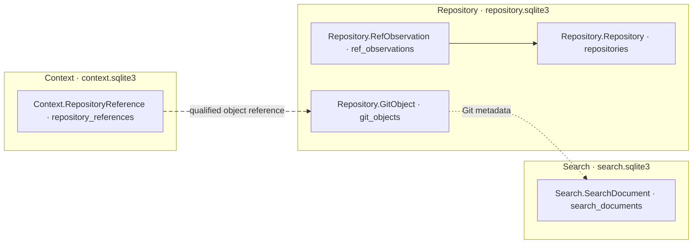

# ADR 0044: Repository store name and fresh-start formats

- **Decision & Context:** Rename the Core responsibility to Repository. This
  store owns permanent Git repository identities, nominal Git objects,
  attributed metadata and ref observations, intrinsic structure, and allowed
  checked representations and Notes evidence. Its store role is `repository`,
  its schema catalogue key is `p1.repository`, and its SQLite filename is
  `repository.sqlite3`. Ordinary initialization uses
  `repo-catalog init --scope repository`. The Python distribution is
  `repo-catalog-repository`, and the SQLite adapter is `RepositoryStore`.
  Persistent class IDs use `Repository.<Class>`, including
  `Repository.Repository` for the existing `repositories` table. Rename
  `core_coverage_proofs` and Context's `core_references` to
  `repository_coverage_proofs` and `repository_references`. The paired scope
  covers Repository and Context. The `git_only` recovery scope selects Repository.
- **Constraints / Do NOT:** Use fresh destinations with the new
  `repo-catalog/p1-isolated-5` family and SQLite `user_version = 5` on the four
  P1 roles. Validate the version before use. An existing `core.sqlite3` blocks
  initialization in its directory before writing a new file. Backup manifest v4
  uses the role `repository` and path `stores/repository.sqlite3`. Exchange v9
  uses the section `repository` with version-appropriate canonical SHA-256
  validation. Reject legacy DBs, backups and Exchange packages before writes
  or creating a restore destination. Preserve existing files and historical
  evidence. Core's INSERT-only authority, qualified cross-store references,
  operation-scoped installation, recovery guarantees and table ownership
  carry forward to Repository. Web follows asynchronously under
  [ADR 0042](0042-asynchronous-web-main-tracking.md).
- **Reason & Ref:** The owner selected a name that identifies the Git repository
  catalog and chose the complete file/format cutover with fresh data. In the
  2026-11-18 implementation conversation the owner selected “ファイルと形式まで”
  and “新形式で作り直す” and then instructed “Implement the proposed plan.”
  This Mini-ADR records a naming and format refinement of the existing model
  and a clean start for this unreleased project. Runtime implementation and
  verification are separate.

## Persistence boundary diagram (target)

The solid edge is a same-file foreign key. The dashed edge is a qualified
reference and the dotted edge shows derivation. This is a representative view
of the proposed names based on the current DDL and
[canonical class mapping](../architecture/persistence-model.json).
