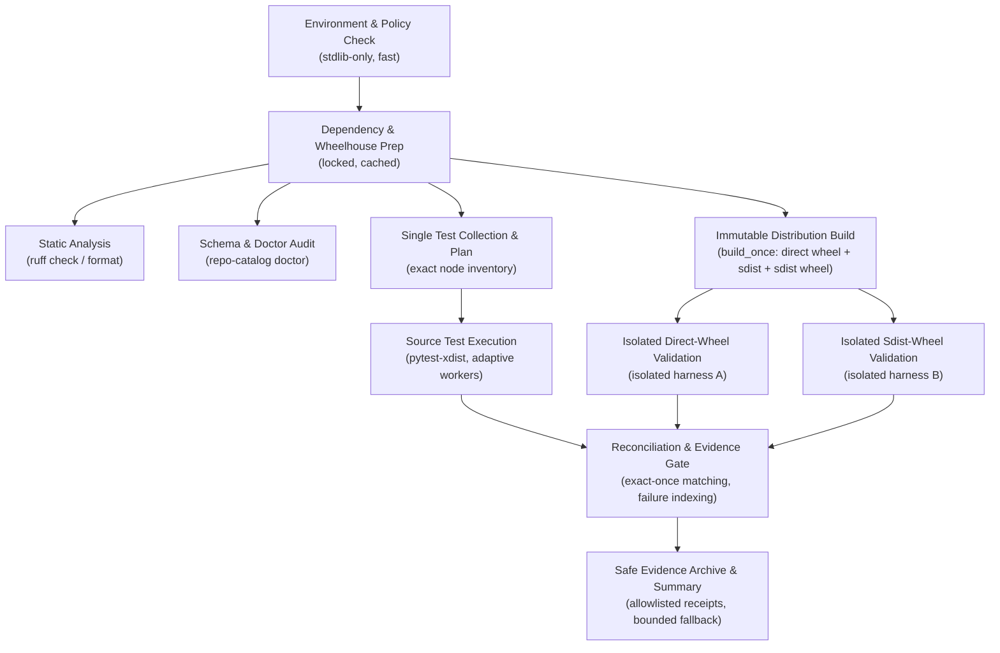

# Verification Efficiency, Resource Scheduling, and Evidence Architecture

**Status:** Owner-adopted design under ADR 0034 on 2026-10-26; final integration verification remains separate

**Date:** 2026-10-25

**Baseline:** `main` HEAD `8dd99b80470d5bdde203556b88c778332f9e92fb`, Tree `f3672ddaecba7b9e25ce6a326d7d305b55960e8b`

**Refines:** ADR 0001 (Validation Lifecycle), ADR 0032 (Environment SQLite), ADR 0033 (Minimal Sdist), ADR 0034 (Efficiency Architecture)

---

The [owner acceptance record](../implementation/adr0034-adoption-20261026.md)
fixes the existing design and repaired build-input identity contract. Item 4's
input fingerprint covers actual content/configuration in source and extracted
sdist build contexts, not only a directory or commit. The current reviewed
Linux recipe refuses unsupported ambiguous contexts; broader platform support
and product changes are not implied. Historical profiles and failed reviews
keep their original results.

## 1. Executive Summary & Design Principles

This document defines the architectural contract for repository-wide test execution, CI scheduling, resource budgeting, and evidence retention.

The primary objective is to substantially reduce local test execution wall time, CI overhead, and AI coding-agent token consumption without compromising:
1. **Safety and Integrity:** Strict isolation of SQLite catalogs, WAL safety floors (SQLite >= 3.51.3), transaction rollback boundaries, and schema integrity guards.
2. **Reconciliation and Evidence Completeness:** Exact test-node multiset matching against JUnit XML, append-only JSONL event journals with `os.fsync` durability, input/runtime hashes, and non-author independent review.
3. **Failure Visibility:** Clear and prominent distinction between genuine regressions and known inherited non-successes (specifically the 43 Transfer-stage non-successes).

---

## 2. Quiet Runner Interface and Token-Efficient Output

### 2.1 The Problem: Terminal Bloat and Model Context Exhaustion
Standard pytest runs emit thousands of progress dots, full tracebacks, and verbose collection listings. When executed within AI coding sessions or CI environments, raw logs consume 50,000 to 200,000 tokens per test run. Furthermore, in-memory buffering of massive subprocess stdout/stderr strings incurs notable memory spikes and risks truncation.

### 2.2 Normal Successful Execution Format
When a validation run completes successfully (all required tests pass and exact reconciliation holds), the terminal output MUST be limited to a compact summary strictly bounded in size (< 300 bytes for test executions; 1–2 lines for non-test operations such as linting, formatting, or dependency synchronization without printing meaningless "0 passed" test statistics).

```text
=== Validation Summary: tests (xdist-4) ===
Invocation ID:   tests-1729864200-a1b2c3d4
Commit & Tree:   8dd99b80470d5bdde203556b88c778332f9e92fb / f3672ddaecba7b9e25ce6a326d7d305b55960e8b
Validation Lane: tests (mode: development)
Outcomes:        Total: 947 | Passed: 947 | Failed: 0 | Skipped: 0 | Inherited: 0 | Unexecuted: 0
Reconciliation:  EXACT_ONCE_MATCH (947 selected == 947 executed == 947 journal starts)
Worker Count:    4 workers (affinity: 4 cpus, memory: 16.2 GB avail)
Wall Duration:   91.09s (cumulative test time: 160.16s)
Exit Status:     SUCCESS (exit code 0)
Evidence Dir:    artifacts/ci-profile/invocations/tests-1729864200-a1b2c3d4/
===========================================
```

For non-test commands (e.g. `scripts/ci_python_runtime.py`, `scripts/preflight_access.py`, or `scripts/ci_execute.py gate`), runners emit a single concise line by default:
```text
ci_python_runtime: SAFE (python: 3.12.15, sqlite: 3.53.1) receipt: artifacts/python-runtime/receipt.json
```
Verbose outputs and debug details are preserved behind explicit `--verbose` flags or `CI_VERBOSE=1`.

### 2.3 Failure Reporting Format
When failures, errors, unexpected skips, or reconciliation mismatches occur, the terminal reporter prints:
1. High-level failure classification (`NEW_REGRESSION`, `ADDED_FAIL`, `CHANGED_FAILURE`, `RECONCILIATION_MISMATCH`, `ENVIRONMENT_FAILURE`).
2. Number of new, changed, or inherited failures.
3. A bounded diagnostic sample: at most 3 representative failure excerpts (capped at 25 lines per failure).
4. Direct filesystem paths to full diagnostic logs, JUnit XML, JSONL journals, and the machine-readable failure index.

Terminal output NEVER dumps full multi-thousand-line tracebacks for every failing test into stdout.

### 2.4 Programmatic Log Filtering and Receipt Extraction
CI workflows (such as `access-registry.yml`) emit complete diagnostic receipts encoded as Base64 strings between `CI_RECEIPTS_BEGIN_V1` and `CI_RECEIPTS_END_V1`. Loading these multi-megabyte payloads directly into AI coding agent context wastes tens of thousands of tokens and causes context window exhaustion.
- The `scripts/ci_query.py filter-log <raw.log> -o <clean.log>` command strips Base64 receipt payload lines while retaining all execution logs and markers.
- The `scripts/ci_query.py extract-receipt <raw.log> -o <out_dir>` command decodes and unpacks Base64 zip archives directly onto disk, allowing on-demand access to artifact files without expanding them in terminal output.

### 2.5 Complete Raw Evidence Retention
Quiet presentation governs terminal presentation and coding-agent context consumption ONLY.
Underlying execution evidence is preserved in full:
- Child subprocess output MUST be streamed directly to filesystem log files (`<name>.log`) via file descriptors, not buffered in process memory.
- `junit.xml`: Full XML containing all `<testcase>` records, error types, and system-out/err.
- `journal.jsonl`: Append-only event stream recording `start`, `phase` (`setup`, `call`, `teardown`), worker ID, duration, and `finish` events with `os.fsync` durability.
- `selected-tests.txt`: Exact ordered list of collected test node IDs.
- `runtime.json`: Actual Python executable, SQLite source ID, compile options, CPU topology, and cgroup quotas.

---

## 3. Machine-Readable Summaries and Selective Failure Retrieval

### 3.1 Execution Summary (`execution-summary.json`)
Every runner invocation writes a compact, normalized JSON summary directly into the invocation evidence directory:

```json
{
  "version": 1,
  "invocation_id": "tests-1729864200-a1b2c3d4",
  "lane": "tests",
  "mode": "development",
  "commit_sha": "8dd99b80470d5bdde203556b88c778332f9e92fb",
  "tree_sha": "f3672ddaecba7b9e25ce6a326d7d305b55960e8b",
  "exit_code": 0,
  "wall_seconds": 91.09,
  "cumulative_test_seconds": 160.16,
  "workers": 4,
  "counts": {
    "total": 947,
    "passed": 947,
    "failed": 0,
    "error": 0,
    "skipped": 0,
    "inherited_failures": 0,
    "unexecuted": 0
  },
  "reconciliation": {
    "status": "EXACT_ONCE_MATCH",
    "selected_count": 947,
    "executed_count": 947,
    "consistent": true
  },
  "artifacts": {
    "log": "tests.log",
    "junit": "junit.xml",
    "journal": "journal.jsonl",
    "failure_index": "failure-index.json"
  }
}
```

### 3.2 Authoritative Failure Classification and Multiset Reconciliation
1. **Authoritative Failure Classification:**
   - Inherited failures (such as the 43 Transfer-stage failures) MUST NEVER be inferred from test names or file-path heuristics (e.g. searching for `"test_transfer_"`).
   - Before reconciliation against the authoritative baseline comparator (`scripts/compare_access_regressions.py`), all failures default to `UNCLASSIFIED_FAILURE`.
   - Authoritative comparison classifies failures into:
     - `STAGE_TRANSFER` (verified inherited known non-successes).
     - `CHANGED_FAILURE` (failing with a different exception or message than baseline; treated as an active regression).
     - `NEW_REGRESSION` (failing nodes that were not in baseline failures).
   - In `scripts/ci_query.py failures --new-only`, only verified inherited failures are excluded; all unclassified, changed, and new failures are reported.
2. **Exact Multiset Reconciliation:**
   - `build_execution_summary()` verifies exact node multiset equality: `Counter(selected_nodes) == Counter(executed_nodes)`.
   - Matching count numbers alone (`len(selected_nodes) == executed_count`) is explicitly rejected as insufficient: if counts match but node multisets diverge, reconciliation reports `NODE_MISMATCH` and fails closed.
3. **Failure Indexing (`failure-index.json`) and Selective Retrieval:**
   - Each failure entry contains:
     - `nodeid`: Exact pytest node ID.
     - `classification`: Classification relative to baseline (`STAGE_TRANSFER`, `UNCLASSIFIED_FAILURE`, `NEW_REGRESSION`, `CHANGED_FAILURE`).
     - `phase`: Failing phase (`setup`, `call`, or `teardown`).
     - `exception_type`: Exception class name.
     - `message`: Short exception summary.
     - `log_byte_offset`: Byte offset range in `<name>.log` where the specific test failure output begins.
   - An agent CLI tool (`scripts/ci_query.py failure --node <nodeid>` or `scripts/ci_query.py failures --new-only --limit N`) allows an AI assistant to fetch ONLY targeted tracebacks without reading entire multi-megabyte log files into context. Query command exit codes strictly distinguish PASS (0), validation failure (1), and missing/corrupted evidence (2).

---

## 4. Adaptive Resource Budgeting and Safe Pytest Parallelization

### 4.1 Safe Worker Selection Algorithm
The repository contains process-global test state (such as environment variable modifications, temporary directories, and SQLite database file locks). Therefore:
- **Process Isolation Only:** Tests MUST run in isolated `pytest-xdist` child processes. Threads are strictly prohibited for test-suite parallelization.
- **Resource Budgeting Rules:** The optimal worker count $W$ is calculated dynamically:
  $$W = \max\left(1, \min\left(W_{\text{cpu}}, W_{\text{mem}}, W_{\text{workload}}, W_{\text{user}}\right)\right)$$
  Where:
  - $W_{\text{cpu}}$: Logical CPU cores available to the current process. Calculated from `len(os.sched_getaffinity(0))` if available; capped by cgroup quota (`cpu.cfs_quota_us / cpu.cfs_period_us` or `cpu.max` in cgroup v2).
  - $W_{\text{mem}}$: Available system memory divided by measured peak worker memory budget (estimated at 350 MB per worker for ordinary tests, 500 MB for packaging/installed tests).
  - $W_{\text{workload}}$: Test case count cap. For small workloads ($N < 20$), $W = 1$ (sequential) to avoid process startup overhead; for $20 \le N < 50$, $W = \min(2, W_{\text{cpu}})$; for $N \ge 50$, $W = W_{\text{cpu}}$.
  - $W_{\text{user}}$: Explicit CLI override (`--workers N` or `CI_WORKERS=N`).

### 4.2 Host-Wide Concurrency Budgeting
To prevent multiple parallel lanes or concurrent agent processes from independently spawning full sets of workers and thrashing host memory/CPU:
- A lightweight host-wide advisory lock (`/tmp/git-repo-db-<uid>-resource.lock`, configurable via `CI_RESOURCE_LOCK` or `--resource-lock`) coordinates active workers across concurrent test lanes and independent worktrees on the same host.
- If concurrent validation jobs are active, each lane scales down to avoid aggregate core oversubscription.

### 4.3 Scheduler Mode
The default scheduling mode for pytest-xdist remains `--dist worksteal` for ordinary test lanes, which dynamically reallocates queued tests from busy workers to idle workers. `loadscope` or `loadfile` may be selected only for test suites with file-level fixture sharing.

---

## 5. Shared Immutable Build Outputs and Workspace Isolation

### 5.1 Content-Addressable Build Reuse (`build_once`)
Repeated execution of distribution builds (`wheel`, `sdist`, and `sdist-derived wheel`) across `test_p1_distribution.py`, `verify_i5_distribution.py`, `verify_access_distribution.py`, and packaging fixtures wastes substantial wall time and disk space.
- The `build_once` mechanism in `tests/support/distributions.py` is generalized into a shared project build utility (`scripts/distribution_build.py` / `tests/support/distributions.py`).
- **Cache Key Fingerprint:** The build cache key is computed over:
  - Git tree hash of package source (`src/repo_catalog/` and packaging configuration `pyproject.toml`, `README.md`).
  - Python interpreter executable SHA-256 and Hatchling build tool version.
  - Sdist inclusion policy and environment SQLite identity.
- **Atomic Publication:** Build outputs are assembled inside a staging directory under an exclusive OS file lock (`fcntl.flock`). Once verified against SHA-256 checksums and the sdist size budget contract, products are published via atomic rename accompanied by `ready.json`.
- **Sealed Immutability:** Any modification or tampering with a published distribution artifact triggers immediate verification failure.

### 5.2 Strict Per-Variant Workspace Isolation
Sharing workspace directories, test harness files, or mutable conftest scripts between direct-wheel and sdist-wheel test executions creates dangerous race conditions.
- Direct-wheel and sdist-wheel runs MUST execute in completely separate directories:
  - `direct-harness/` with its own `conftest.py`, `artifact-files.json`, and isolated `sitecustomize.py`.
  - `sdist-harness/` with its own isolated files.
- Each variant uses a distinct temporary virtual environment, distinct `PYTHONPATH`, distinct catalog databases, and independent HTTP/Git mock servers.
- Variant validation runs MAY execute concurrently only after their workspaces and virtual environments are fully materialized.

---

## 6. Consolidated Collection and CI Task Scheduling

### 6.1 Single-Pass Test Collection
`verify_i5_offline.py` currently invokes `pytest --collect-only` four separate times (for `all`, `ordinary`, `offline`, and `ci`). On a 4-core machine, this accounts for ~14.5 seconds of pure overhead.
- **Consolidation:** Run a single collection pass querying pytest's collection tree with `-o addopts=` and extracting test markers (`live`, `benchmark`, and path targets).
- **Exact Multiset Equivalence:** The consolidated collector partitions the nodes into:
  - `ci`: Nodes matching the authoritative Access CI targets (excluding live and benchmark).
  - `ordinary`: All acceptance test nodes (excluding live and benchmark).
  - `benchmarks`: Offline benchmark nodes.
  - `live_not_run`: Live network nodes.
- Preserves exact node multiset counts, duplicates detection, and sorting invariants identical to the multi-pass baseline.

### 6.2 CI Task Dependency Graph
The CI pipeline is structured into a DAG (Directed Acyclic Graph) of independent and sequential stages:



---

## 7. Artifact Inclusion and Exclusion Policy

### 7.1 The Problem: Hundreds of Megabytes of Disposable Workspace Bloat
In current CI runs, `artifacts/access-registry/` accumulates:
- `source.tar` (401 MB uncompressed tar archive)
- `source/` (421 MB expanded source tree)
- `direct-venv/` and `sdist-venv/` (29 MB virtual environments)
- `from-sdist/` (7 MB extracted sdist)
Uploading this directory produces a 725 MB zipped artifact taking 40 seconds of CI upload time and exhausting GitHub Actions artifact storage.

### 7.2 Strict Evidence Allowlist
Temporary workspaces, virtualenvs, and expanded source archives MUST be located in a dedicated scratch directory (`tempfile.TemporaryDirectory` or `.tmp/`) outside the final artifact directory.
The uploaded artifact bundle (`artifacts/access-registry/` or `ci-profile-*`) MUST contain ONLY verified evidence:

**Allowed Artifacts:**
1. Raw test execution logs (`*.log`).
2. JUnit XML files (`*.xml`).
3. Append-only JSONL journals (`*.jsonl`).
4. Machine-readable summaries and indices (`*.json`):
   - `summary.json`, `execution-summary.json`, `failure-index.json`.
   - `selected-tests.txt` (exact node IDs).
   - `sdist-contract.json` (sdist member inventory and byte counts).
   - `build-binding.json`, `test-support-binding.json`, `wheelhouse-binding.json`.
   - `runtime-before-checks.json`, `preflight.json`, `failure-comparison.json`.
5. Markdown summaries (`*.md`).
6. Minimal source reproduction archive: `source.tar.gz` (compressed, <= 2 MB).
7. Locked formatter executable (`ruff`) if required for offline reproduction.

**Explicitly Excluded from Upload:**
- Uncompressed source archives (`source.tar`).
- Expanded source trees (`source/`, `from-sdist/`, `outside/`).
- Python virtual environments (`*-venv/`, `.venv/`).
- Bytecode caches (`__pycache__/`, `*.pyc`).
- Temporary database catalogs (`*.sqlite3`, `locks/`).

---

## 8. Performance Acceptance Methodology

To prevent speculative or unverified claims, all performance improvements MUST be evaluated against baseline measurements under controlled conditions:
1. **Measured Metrics:**
   - Wall time ($T_{\text{wall}}$ in seconds).
   - Total CPU time ($T_{\text{cpu}} = T_{\text{user}} + T_{\text{sys}}$).
   - Peak resident memory (RSS in MB via `getrusage(RUSAGE_CHILDREN)`).
   - Worker process count.
   - Selected and executed node counts (exactly reconciled).
   - Number and classification of failures (43 Transfer-stage failures preserved).
   - Console output bytes (terminal bytes transmitted).
   - Uploaded artifact bundle bytes (uncompressed and compressed).
2. **Cold vs Warm Cache:**
   - Distinguish cold execution (initial dependency sync and distribution build) from warm execution (cached wheels, pre-built distribution products).
3. **No Coverage Compromise:**
   - Every acceptance test node must execute and reconcile.
   - Any test skip or silent omission is a blocking correctness failure.
