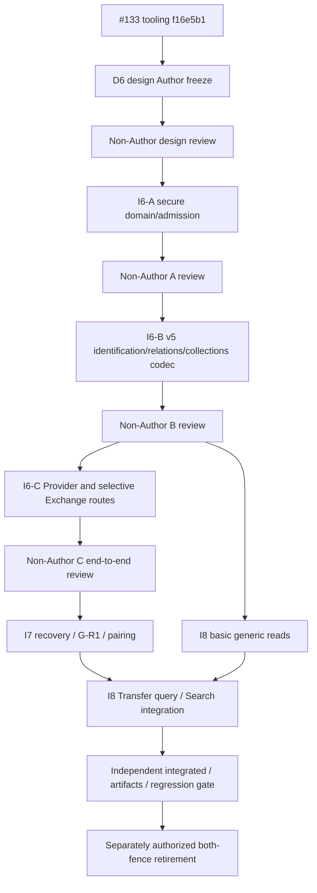

# ADR 0031 I6 source map, implementation graph and independent review handoff

This is the Design Author's companion to the
[boundary contract](adr0031-i6-wire-admission-exchange.md) and
[vectors/test matrix](adr0031-i6-vectors-and-tests.md). The contract specifies
future behavior; the source observations below describe the effective #132 tree,
also present in selected base #133. No production edits are made here.

## Findings to requirements

The [I5 independent report](evidence/adr0031-i5/independent/REPORT.md) and
[findings register](evidence/adr0031-i5/independent/findings.json) are frozen
evidence, not predictions. A design requirement does not mark a product finding
fixed. Separate non-Author review and later executable evidence must close it.

| Finding / inherited status | Required design closure | Test/evidence gate |
| --- | --- | --- |
| I5-A1 Medium, reproduced open boundary | R10–12: mandatory AdmissionContext at public store/facade and every external route; selected Resource/Repository/Source closure and current authorization before existence/replay shortcuts; lease held through commit | T07–10/14/26; deny each dependency separately and deny an exact replay with existing rows and cached receipt |
| I5-B1 Medium, reproduced open boundary | R08: mandatory complete original ParentReportKey plus original observation payload; no Event-clock/provenance/member synthesis; independent child still admissible | V02–04/V08; T02–04/15/16; original Parent 50/P/51 and Event 100/E/101 |
| I5-C1 Medium, reproduced open boundary | R09: mandatory pre-filter ProviderEndpointDeclaration and original translated endpoint set; strict equality with received rows; no `endpoints=None` or role synthesis | V04–08; T05/06/14–16; genuine one-sided versus truncated two-sided, including replay/import permutations |
| I5-D1 Low, independently verified rollback PASS | R15 preserves SAVEPOINT behavior and makes second-INSERT failure mandatory evidence; retain the independent result as historical fact | T17 SQL trace proves first INSERT reached, second failed in-flight, full rollback; separate preflight test remains |
| I5-F1 Low, facade mitigation verified | R16 requires both-trigger/definition inspection and fail-closed partial/unknown state; retain full schema validation | T19 normal facade, low-level helper and installed packages; not a claim of a code fix in this PR |
| I4-E1 Low, open evidence-scope carryover | Record full sdist input set separately from runtime/wheel inputs and later evidence publication | T24/25 and exact build/publication inventories; no historical receipt rewrite |
| Task G G-R1 Medium, I7 carryover | R17 candidate global/scoped reconciliation remains I7-owned | T21–23; no claim of closure from I6 wire preservation |

G3=A is fixed, not an owner question: I8 support is permanently ineligible for an
I7-native Event; missing eligible I7 report is temporary dependency withholding
and needs explicit original resupply. Retain all lawful I8 reports independently.

## Source-level investigation and intended changes

Anchors are line numbers at #133 `f16e5b1` / unchanged product files from #132
`a022dd3`. Later implementers must search symbols again after edits. Paths in this
table are relative to `src/repo_catalog/`. These are proposed edits only.

| File / symbols | Observed behavior → required change / owner |
| --- | --- |
| `domain/resource_identity.py:29,81,118,165` | Already strict bounded canonical identity codec. Reuse its exact string/list grammar, scanner, escaped byte and node limits; no competing wire encoder or common coercion. I6-B adds roundtrip/cap tests, not a new identity authority. |
| `domain/resource_identification.py:30,59,125` | Explicit four-column declaration already separates namespace from report existence and revalidates duplicates. Add exact named-field v5 encode/decode using this validator. Preserve global-document repetition and known namespace dispatch; no array-shape inference. I6-B. |
| `domain/p1_context.py:783,1723,1753–2145` | FieldClock, EventReportKey, TransferEventReport, `__post_init__`, `from_targets`, `from_stored_scope` and `provided_roles`: optional Parent fields currently borrow Event originals; endpoint/role defaults derive from surviving relations. I6-A makes original Parent/key/time and declaration mandatory; creates an explicitly non-admissible incomplete type if needed. Remove every synthesis/replay bypass, preserve independent clocks and complete endpoint references. |
| `domain/parent_report.py:30,69` | Existing direct ParentReportKey is the basis, not a new identity. Add a complete immutable Parent observation carrier/lookup result binding its own original time. Keep existing seven PK components and singleton typed constraints. I6-A. |
| `domain/transfer_sql.py:21,103` | Existing bounded Event and endpoint predicates enforce the exact nine-key scope, Parent support and role/member consistency. Reuse and, if needed, tighten canonical declaration-order checks without weakening native-I7 SQL, complete reference FKs or stage fences. I6-A. |
| `domain/production_context.py:200–330` | ResourceObservation already carries identification; ResourceRelation, CollectionObservation and SourceInventory distinguish ordered members versus set inventory. Expose bounded common dependency enumeration and strict replay contracts; no sorted Collection members, fabricated terminal or altered Coverage dimensions. I6-A/B. |
| `domain/resource_stage.py:29,61,72` | `preflight_transfer` fences selected operation names; `has_transfer_fence` reads only endpoint fence and catches errors as staged. I6-A inspects both expected definitions/unsupported states; B/C selectively replace identification refusal after supported v5 decode while Transfer refusal remains. |
| `domain/selective_exchange.py:23,36,77` | Resource decoder drops identification; endpoint decoder accepts missing full-report fields through `.get`; `transfer_reports` reconstructs report by Event key. I6-B requires exact v5 fields and explicit declaration/original Parent; missing references cannot be filled from rows. |
| `domain/selective_exchange.py:147,579` `filter_sections` / `expand_resources` | Whole-member and Transfer filtering exists but permissions are Repository-focused; all relation/Collection member edges expand, Provider support adds edges. Add Resource/Source/claim policy checks and bounded dependency plan shared by sender/receiver; preserve original declarations/terminals and whole-unit withholding. Namespace is already excluded from expansion: preserve that. I6-B/C. |
| `domain/selective_exchange.py:657–674` `preflight_i2_resources/context` | Blanket refusal for review/thread/comment/document because v4 lacks identification. Replace with exact v5 identification validation; do not merely delete guards or treat arbitrary keys as declarations. Transfer operation refusal remains until integrated retirement. I6-B/C. |
| `domain/selective_exchange.py:674,791` `validate_context/bindings` | Resources currently validate only key triples. Known plural child groups compare `scoped_document_coordinates()` with owner. Decode explicit identification once; distinguish named known ownership semantics from general semantic Parent. No global Document scoped-parser fallback or Parent existence check for identity registration. I6-B. |
| `domain/selective_exchange.py:887,1083,1184` | `bound_sections`, proof/terminal validation and Coverage preservation already protect whole dependencies and real terminals. Extend semantic units to explicit original Parent/report/endpoint dependencies and current grants; count actual work, preserve withheld terminal alternatives and honest limit stops. I6-B/C. |
| `domain/exchange.py:27,162,233,418,478` | v4 FORMAT, outer caps/digest, selection scope, package grammar. I6-B versions to exact v5, retains outer canonical profile and PackageKey semantics, rejects unknown/missing version, preserves domain-only registrations and strict selection primitive types (no bool/int coercion in decoder). |
| `domain/exchange_rows.py:7,304,482` | v4 ROW_KEYS omit four identifying columns and endpoint full-report refs. Add exact v5 profiles; validate types/unknown fields before reconstruction, preserve replay scope/time checks. Do not use a digest as a domain key. I6-B. |
| `adapters/sqlite/p1_context.py:127,152,333` | Resource registration already has explicit identification and no Parent registration walk. `admit_transfer_event` has structural checks/SAVEPOINT but no caller context/current grant checks and compares endpoint sets after optional synthesis. I6-A requires AdmissionContext, full original key/time/declaration and qualified dependency checks before duplicate shortcut. Preserve in-flight rollback and I4 SQL. |
| `adapters/sqlite/production_context.py:482,521,568,583,596,676,898` | Resource, inheritance, `_members`, `_parent_dependencies`, relation/Collection facade and Transfer facade. Relation permits unrestricted `None` policy; Transfer has no permission context. Untrusted paths must require context; common writer cannot be selected as a bypass. Preserve known child collection semantics and independently validated semantic Parent referents. Add tests for a global Document owning children. I6-A/B/C. |
| `application/acquisition.py:1185,1210,1278,1420,1440,1463,1476` | `_ensure_resource_hierarchy` no longer walks native Parent but can fetch existing identification; `_register_reference` also uses stored declaration for known kinds. Require supplied declaration for newly referenced Resources, or authorized validated existing declaration; never infer/register namespace Parent. `_preflight_units` refuses Transfer. `_admit_transfer_unit` derives roles, mappings and report, then may substitute a prior report by clock/provenance. I6-C passes mandatory originals/declaration/context, verifies actual event semantics, rechecks prior originals and qualified mapping before replay, removes permissive fallback. Stage refusal stays. |
| `application/exchange.py:1157–1208` | Export reads only three Resource columns and eight endpoint fields before blanket identification refusal. Read all seven Resource columns and both endpoint references; preserve originals before filtering/limits. I6-C. |
| `application/exchange.py:1470–1750,2065–2490` | Import accepts Repository permissions, filters then dependency pass reads broad existing rows. I6-C supplies receiver-local Resource/Source/claim authority; scope authorized local lookups and accounting. Package receipt shortcut cannot bypass current permission/eligibility. No denied-row existence disclosure. |
| `application/exchange.py:2299–2326` `_context_dependencies` | **Legacy registration prerequisite:** scoped kinds derive native Parent from ID and wait until it exists, reporting `missing_parent_or_provider`. Remove native Parent dependency/loop; require Provider registration plus explicit complete identification only. Parent report and Transfer units separately require real referents. I6-C. |
| `application/exchange.py:2990–3090,3200+` `_import_context_into` | **Legacy parent-first resource sorting**, `ctx.resource(rk)` drops identification; Transfer admitted before generic/Parent reports. Replace registration sort with independent Resources carrying declarations; admit Parent/mapping support before whole Transfer; shared guarded API for every unit. I6-C. |
| `application/production_query.py:1050,1190` | Resource views already expose identifier namespace separately; semantic `parent` list filter still refuses, `transfer_summary` is absent in inherited failures. I8 adds semantic Parent views and Transfer integration without identifier inference or winner selection. I6 only supplies stable codec/contract. |
| `adapters/sqlite/recovery_validation.py:63,79,172,219` | Reconstructs identifications and Parent reports; endpoint SELECT/reconstruction omits the two complete Event reference fields, staged storage refuses Transfer. I7 reads complete durable forms, trusted validators and full keys/declared endpoint equality, preserving Recovery Stop. I6-A exports shared pure validation interface; no premature normal recovery acceptance. |

### Namespace and Parent assumptions: remove versus retain

The source scan covered the named files plus `domain/parent_report.py`,
`domain/production_context.py`, `domain/context_registration.py` and every
`scoped_document_coordinates` / `identifier_namespace` consumer in application,
domain and SQLite adapters. Within that scanned source, the remaining explicit
native-Parent **registration** requirement is the Exchange dependency loop; the
parent-first import ranking and stripped Resource export/import reinforce it.
The acquisition helper's old name is misleading but its current body does not
register a Parent. It instead needs declaration propagation for new references.
Do not restore hierarchy inference to solve missing identification.

The following are intentional typed dependencies, not universal registration
prerequisites: known plural child list ownership checks in `_members` and
`validate_context_bindings`; explicit `inherit_fields(parent,child)` needing its
actual operands; semantic Parent report referent checks; and native-I7/full
Parent-report dependencies for **Transfer**. Use identification declarations for
known native scope checks and resource_relations for actual Parent facts. Queries
may expose identifier namespace coordinates without claiming a Parent report.
The scoped parser/Timeline Event native checker remains for its known contract,
not arbitrary Resource graph traversal. Re-run the callsite scan at each frozen
implementation boundary; additions must be classified, not excluded by prefix.

## Manageable implementation PRs and stable interfaces

All branches below are proposals, require separate implementation authorization,
and must be pinned to reviewed exact commits when created. D6 is documentation
only. Reviews are separate non-Author freezes, not the Author reviewing itself.

**I6-A — `impl/adr0031-i6a-secure-admission`.** Depends on reviewed D6 and
unchanged I4/I5 product ancestry. Files: `domain/p1_context.py`,
`domain/parent_report.py`, `domain/production_context.py`,
`domain/transfer_sql.py`, `domain/resource_stage.py`, proposed
`domain/context_admission.py` and
`domain/ports/context_authorization.py`, `adapters/sqlite/p1_context.py`,
`adapters/sqlite/production_context.py`; update affected call signatures only in
`application/acquisition.py` / `application/exchange.py` to keep them fail closed
until C. If declaration/projection guards need extension, change only existing
`adapters/sqlite/p1_ddl/context.sql`, `p1_schema.py` registration/verification and
`p1_ddl/fingerprints.json` together, retaining native-I7/full-report FKs and both
fences. No new domain table. New tests proposed under
`tests/unit/test_context_admission.py`, plus existing
`tests/integration/p3/test_transfer_admission.py` and `test_transfer_sql.py`.

Public contract: mandatory originals and declarations; immutable complete types;
mandatory AdmissionContext; pure `dependencies(unit)` / `validate_originals(unit)`
separated from authorized current snapshot checks. Refusal codes R12 are stable.
Test focus T02–09/13/17–20/26/27 and all inherited 29 I5/217 I4 obligations, without
count-only acceptance. Evidence: independent reproductions of A1/B1/C1, SQL trace
rollback, both-fence state, deny-all store/facade and replay, distributions with
actual installed origins, explicit normal stage refusal. Freeze A for non-Author
review before B relies on it; material corrections get re-review.

**I6-B — `impl/adr0031-i6b-generalized-wire`.** Stack on accepted A review freeze.
Files: `domain/resource_identification.py`, `resource_identity.py` only if a real
codec defect is demonstrated, `production_context.py`, `selective_exchange.py`,
`exchange.py`, `exchange_rows.py`, proposed `domain/context_wire.py`; unit tests
proposed `tests/unit/test_context_wire_v5.py` and focused additions to
`tests/integration/i3/test_selective_exchange.py`. Normal application wire routes
remain fenced until C connects the complete codec; Transfer stays fenced.

Public contract: exact v5 row/envelope schemas R02–09; named identification
roundtrip; pure bounded `decode_context_v5` / `encode_context_v5` and
`plan_context_dependencies` returning whole semantic units and typed omissions,
never an authorization grant. Collections/Source/Coverage use existing authorities
and real terminal APIs. Test focus T01–06/10–13/18/24/27 plus malformed versions,
all explicit vectors, cap boundaries and ordering. Evidence: exact JSON bytes,
digest recomputation, source/installed codec origins, stage refusal, independent
non-Author protocol review/counterexamples at frozen B. SQL schema changes are
not a prerequisite merely to transport the existing identification columns.

**I6-C — `impl/adr0031-i6c-provider-selective-exchange`.** Stack on accepted B
review freeze. Files: `application/acquisition.py`, `application/exchange.py`,
`domain/acquisition.py`, `domain/ports/acquisition.py`,
`adapters/github/production_intake.py` (including `NormalizedContextUnit` and
`normalize_timeline_event`), `domain/selective_exchange.py`,
`adapters/sqlite/production_context.py`, and composition-root/CLI callers that
construct AdmissionContext (locate all callsites; no blanket exemption).
Proposed tests `tests/integration/i6/test_wire_routes.py`, plus existing
`tests/integration/i2/test_provider_intake.py`,
`i23/test_provider_exchange.py`, `i3/test_selective_exchange.py`,
`p5/test_provider_acquisition.py`, `p5/test_exchange.py`, and packaging probes.

Public contract: every route uses A's same mandatory boundary and B's same codec;
normalized Provider units carry original Parent observation and pre-filter endpoint
declaration; selection planner and dependency checks share semantic-unit keys;
package/row replay revalidates current authority. Read all seven Resource columns
and both Event reference fields; no native Parent registration loop. Test focus
T02–16/24–27, partial GraphQL/REST normalization, late/reverse/onward delivery,
source current positives and actual whole-unit omissions. Evidence: independently
executed sender→wire→receiver cases under an explicit synthetic isolated harness,
normal product refusal, route/callsite audit, distribution runs and honest
regression delta. Non-Author C review must demonstrate no bypass through any
untrusted Provider/Exchange path. This is route implementation readiness, not
normal Transfer activation; both fences remain.

**I7 — `impl/adr0031-i7-recovery`.** Depends on frozen reviewed A/B/C durable
forms. Files: `adapters/sqlite/recovery_validation.py`, `recovery.py`,
`production_context.py`, actual backup/domain recovery codecs and pairing
manifests and `application/recovery.py`; candidate decoder/scoping
consumers for G-R1. Reuse the A/B validators rather than a weaker salvage decoder.
Tests under `tests/integration/p7`, existing corruption fixtures and installed
recovery probes, T19–22/24–27. Evidence includes source Stop plus destination
refusal, genuine IO/budget negative controls, paired backup and fresh activation
fence, frozen payload formats and independent recovery review. Do not claim
Recovery acceptance from clean FK checks or copying SQLite files.

**I8 — `impl/adr0031-i8-query`.** Basic generic views may start at reviewed B;
Transfer integration depends on reviewed C/I7. Files:
`application/production_query.py`, `domain/production_query.py`,
`adapters/sqlite/production_search.py`, Search generation/rebuild consumers and
tests under `tests/integration/p6`, `tests/integration/i4`, plus inherited
Transfer-summary nodes. Public contract R18 separates namespace, semantic Parent,
attributed reports and currently effective qualified Transfer. Tests T23–27;
independent query/Search review verifies actual authoritative scan/fallback parity.
No blanket acceptance of currently unexecuted assertions.

**Integrated gate — `integration/adr0031-transfer-gates`.** Stack frozen reviewed
C/I7/I8, record actual parents/effective tree. Require T01–27, ordinary and
artifact exact-node reconciliation, all-79 failure disposition and independent
non-Author final-tree review. A later separately authorized retirement commit
changes both fence definitions and corresponding application guards/schema
expectations together, and re-executes normal product end-to-end routes without
test-only fence removal. It must show unsupported/tampered schema refusal after
retirement as well. No fixture-only positive proves normal route acceptance.

## Independent-review instructions and freeze protocol

1. Fetch live D6 base/head/PR and all branches; verify sole parent is #133's exact
   `f16e5b1713bde9a2f18263a25397c4b450fd5773`. Compare assigned #132 ancestry,
   selected #133 tree, final Author HEAD/tree and GitHub test-merge parents/tree.
   A moved base requires explicit revalidation, not silently accepting its badge.
2. Work read only against the frozen Author commit. This task requests a later
   separate non-Author review; no independent PASS is claimed or manufactured by
   the Design Author. Publish review separately without mutating D6, #129–#133,
   accepted ADR bodies or historical evidence. List findings with severity,
   requirement/vector ID, source anchor, counterexample and proposed correction.
3. Review decision/contract compatibility, caller denial/replay, independent
   originals, declaration completeness, namespace versus Parent separation,
   finite cycle/closure behavior, real terminals/Source/Coverage, SQL versus
   authentication claims, I7/I8 handoff and feasible PR boundaries. Build at least
   one independent counterexample per I5 Medium and inspect the D1/F1 test design.
   A structural JSON check alone does not prove the contract coherent.
4. For this documentation review, validate UTF-8/links/fences, exact diff scope,
   immutable old blobs and actual source citations. Do not describe design vectors
   as executed product tests. Later implementation reviewers independently execute
   adversarial cases on their selected Python's actual SQLite under ADR 0032,
   with source/artifact bindings, raw outcomes and omissions; no extra engines.
5. Freeze any material Author correction as a new commit, explicitly name the
   delta and request re-review against that tree. Preserve the previous review's
   scope and outcomes. Do not amend/force-push a reviewed freeze to hide changes.

No genuine owner-level decision remains in the current fixed ADR 0031 scope.
Recommended engineering choices frozen here are v5-only intake, mandatory
originals in admission-capable types, a mandatory local authorization port,
reuse of the nine-field Event scope, and both-trigger fail-closed inspection.
They remain reviewable implementation specifications, not invented owner votes.
If review finds a real conflict in persistent meaning/trust/backup scope, isolate
the exact incompatible clauses, show a concrete alternative and recommendation,
and return that specific choice to the owner. A missing adapter, numerical
tuning, unfinished implementation or absent implementation permission is not
itself a new owner-level design blocker.

## Documentation inventory and verification scope

This task adds three Markdown files (the contract, vectors/tests and this source
map) and a short current-entrypoint link in `context-resource-design-handoff.md`.
Accepted ADR bodies, production source, packaged DDL/fingerprints, tests,
dependencies/workflows, old evidence and other PR branches are unchanged.
The Draft PR description records exact final HEAD/tree, sole parent, diff,
validation commands/results and hosted check limits. It is the external freeze
manifest. No production test/build execution is claimed for this design-only
delta; planned tests and inherited runtime results are clearly distinguished.

Applied repository procedures: `efficient-repository-investigation`,
`lessons-to-skills` (including design-only stack updates) and
`ci-final-tree-verification`; managed environment runtime skill for setup.
Lesson assessment: existing stack-pin and current-versus-historical procedures
already cover this task; no newly verified reusable runtime repair was performed,
so no speculative skill or duplicate recipe is added.
