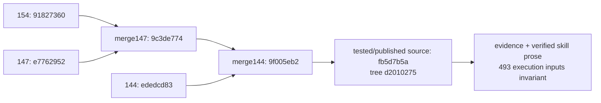

# Actual integration ancestry

Full object identities and trees are in `integration-identities.json`; `dag.txt.gz`
is the recorded Git graph. Arrows run from parent to child. Both reviewed branch
histories are retained; PR150 is reference only and not an ancestor.

All three reviewed inputs share merge-base133 `f16e5b1713bde9a2f18263a25397c4b450fd5773`.
The actual initial CI checkout `c915fc731bd60339e681a6af8f86a470058a5e06` has
ordered parents154/source and exactly the tested source tree. Final evidence
publication HEAD/tree and its actual CI test-merge are externally bound in PR155.
