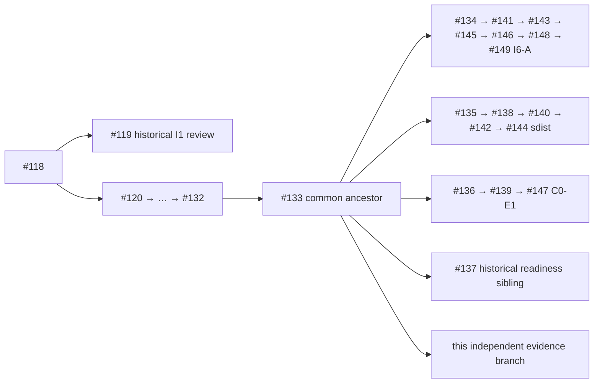

# Task B: fixed parallel-stack integration impact audit

**Disposition: submit the evidence/plan as Draft; product integration remains
unaccepted.** All six order simulations reach the same tree after two explicit
union resolutions. The scoped tests and distribution checks below pass, while
the unchanged original Access smoke fails in each installed form. No bounded
CI defect requiring a separate repair PR was established.

This new document/evidence series starts directly at #133's real branch
`fix/adr0032-host-runtime-20261022`, frozen at
`f16e5b1713bde9a2f18263a25397c4b450fd5773` / tree
`6bfa580baafa9f6a117b7a0b610c4e65cd031b86`. That is a **documentary base**,
not the current I6-A code under audit. This PR changes one procedural skill and
adds this evidence directory; it does not integrate any product branch.
Synthetic merge commits/worktrees are local validation objects only and are not
pushed as product integration branches. No existing PR/base, accepted ADR,
historical evidence, safety predicate, fence or assertion was modified. No merge,
release, deployment, protection change, I6-B/C/I7/I8 implementation or live data
operation was performed. The user authorized this new branch/commit/push/Draft PR.

## Frozen inputs and actual topology

| Series | Reviewed publication HEAD | Actual tree |
| --- | --- | --- |
| I6-A #149 | `ea43a21fca1dbf8fa6dd1c254b28a96d5dd28d00` | `e7ca7e361b8b766f1976a12fc84d5cc50ac32232` |
| sdist #144 | `ededcd83eb2d99a602ba18c8fe3c177125c825ac` | `2c721a0e8a58ebe8d1f795da821ea4e317b73e7e` |
| C0-E1 #147 | `e7762952e18061de8c8235beaeddf42f20ad9f5a` | `9c220c6606703aa36606896eb52d0a8966914a36` |

Startup GitHub API commit trees and real fetched objects match all pins. All
six pairwise merge bases among these three heads and #133 are exactly #133's
frozen HEAD. A plain fetch initially covered only main; the explicit all-heads
fetch and object checks are recorded. The complete startup inventory contains
34 open PRs and 16 recently closed/merged PRs numbered >=100; all 50 heads,
API bases, trees, actual merge bases and ancestry-reduced edges are retained in
[the DAG inventory](raw/github-start.json) and [DAG rendering](DAG.md).
[Exact API/tree checks](raw/fixed-api-start.json) include #119/#137/#148 as well.

The current main pin and its real ancestry are in
[main topology](raw/main-topology.json): main is `cb532242c7aa86c6af5b6232b71c0906ea38f5c5`,
tree `318ad07874ab436206e6a61f231b308a421cfc54`. Its merge-base with the fixed
heads is `d92377599a50f192f534836fc12402a5fe87ca83`. Main's merge commit is
not itself an ancestor of these feature heads. A read-only merge-tree simulation
of this exact main with the resolved candidate is clean and returns the same
candidate tree. This qualifies the current effective tree only; a later main
change requires fresh topology/effective-tree verification and separate merge
authorization. It is not a retarget instruction.

The diagram contracts intermediate edges; the JSON/DAG table is authoritative.
In particular #137 forked from an older #135 commit (`217cf200...`), shares that
merge-base with #144 and is not its ancestor. #119 is a sibling of the present
implementation chain with merge-base #118. Neither old review establishes
current independent acceptance. See [review bindings and dependencies](DESIGN-REVIEW.md).

## Text conflicts and semantic interactions

Recomputed shared paths total **six**, all between I6-A and sdist. C0 shares no
changed path with either sibling relative to #133. Shared files are not the
same as merge conflicts:

| Shared path | Text outcome | Required semantic preservation |
| --- | --- | --- |
| `.agents/skills/ci-final-tree-verification/SKILL.md` | conflict at independent appended lessons | Preserve both I6-A and sdist lessons; this PR's new procedure uses an earlier section and independently preflights cleanly. |
| `tests/packaging/test_p1_distribution.py` | conflict between new imports | Keep `stage_support` **and** `check_sdist`/`compare_wheels`/`save`; retain both fixture staging and direct/derived equivalence assertions. Actual two-node packaging run passes. |
| `.github/workflows/access-registry.yml` | clean textual merge | Retain both sets of paths, actual cohorts, runtime selection, failure propagation and always-run evidence upload. Duplicate equivalent verifier path entries are harmless, not complete I6 coverage. |
| `scripts/verify_access_distribution.py` | clean textual merge | Keep explicit fixture authority for test setup and archive/whole-wheel checks. Original Access smoke still fails; do not broaden grants. |
| `scripts/verify_i4_distribution.py` | clean textual merge | Preserve archive validation before extraction, metadata/RECORD equivalence and isolated installed-test support, import binding and reconciliation. |
| `scripts/verify_i5_distribution.py` | clean textual merge | Preserve the same checks plus both I5/I4 cohorts and original smoke nonzero exit. |

[Overlap data](raw/fixed-overlap.json), [unresolved simulations](raw/merge-simulations.json),
[resolved candidates](raw/resolved-candidates.json) and six exact resolution
patches preserve each input/order/merge-base/output/exit. The union hypothesis
changes only the two conflict files relative to each auto-merged tree. Every
order resolves to **`2c61c7d79bf9a95c4f04ccdbda8fae1fe15d5491`**. Tested detached
commit: `a7825249e0722053a66919d47ad92662854c856c` (I6-A → sdist → C0).
Commit IDs differ by merge parent order; effective trees agree. A separate
non-author reconstruction using independent commit objects also agrees.

The candidate `src` subtree is byte-identical to #149; no source file was chosen
from the older sdist sibling. Its `check_sdist_contract.py`, `ci_plan.py`,
`ci_dependencies.json` and `ci_execute.py` are exactly #144's versions; its
`emit_ci_evidence.py` is exactly #147's version. Clean textual independence does
not eliminate their semantic interaction: the planner must select the new
sdist preparation for distribution inputs, installed harnesses must remain
outside the package, and the closed compressed receipt still has the C0 2 MiB
ceiling. Seven actual emitter regression nodes and the archive/planner cases are
included in the source cohort; full hosted combined Access receipt overflow and
artifact-upload fallback were not executed here.

## Executed validation, failures and omissions

Every bound command uses clean candidate inputs SHA-256
`45597d8e58e72dc392527314118a5d561839dd5891ff9ddccffb4bac7327ac16`.
Raw per-invocation manifests, HEAD/tree, argv, cwd, exits, collection, JUnit and
journals are in [the indexed raw archive](raw-evidence.zip), with
[the member index](raw-evidence-index.json). Helper sources are preserved as
execution evidence, including failed harness versions. Read-only/API and merge
commands are also retained. The source hash excludes documents/evidence and is
not represented as CI's separate acceptance fingerprint.

| Execution on the candidate | Actual result |
| --- | --- |
| Source I6-A, originals/fences, installed harness, CI planner/emitter, sdist contract/hardening | **560 passed**, exit 0; exact 560 selected/JUnit/journal nodes and 1,680 passing phases |
| Conflicted shared P1 packaging test, both artifact parameters | **2 passed**, exit 0; separate exact-node reconciliation |
| Installed direct wheel, then sdist-derived wheel | **each I6-focused 290, I4 217, I5 29 passed**; collection/JUnit/journal and process exits reconciled; I6 repeats are a subset of the source cohort |
| Installed I2/I3 probes and safety/runtime probe | pass on both forms; real installed origins checked |
| Original Access smoke on each installed form | **exit 1**, `AdmissionRefused: PERMISSION_DENIED` in `exchange.py:397`; overall original distribution driver **exit 1** |
| Complete source inventory only | 6,231 collected: 6,229 ordinary + one live + one benchmark; not a full execution |
| Ruff lint and format over `src tests scripts` | both exit 0; 448 files formatted |
| Single-file routing assertions | 18 applicable cases across fixed siblings, plus 14 on combined candidate, all passed; custom Python/PyYAML harness, not pytest or runtime acceptance |

The original smoke reaches the **permission** boundary before later assertions;
it is not the older #133/sdist `I2_TRANSFER_UNSUPPORTED` stop. Current failures
match the I6-A historical logs exactly after only the observed harness/venv path
prefix substitutions; raw logs and [comparison](raw/access-smoke-comparison.json)
are retained. No permission grant, skip/xfail, fence removal or assertion change
was used to convert that failure to success. The successful isolated I4/I5
positives do not accept ordinary Transfer.

The complete ordinary source suite was not run: **5,667 ordinary source nodes**,
one live and one benchmark remain unexecuted from source in this audit. Installed
repeats are reported separately, not added as unique full-suite source coverage.
The older independently recorded baselines stay distinct: #133/sdist's 79
unsuccessful nodes versus current I6-A's 299 (242 I6-C / 14 I7 composition / 43
Transfer-stage). Those broad failures were not rerun, repaired or accepted here.
[DESIGN-REVIEW.md](DESIGN-REVIEW.md) binds every inherited count to its own source.
No complete local+hosted Release acceptance or Transfer activation is claimed.

Selected runtime: CPython **3.12.14**, its built-in SQLite **3.53.1**, source ID
`2026-05-05 10:34:17 c88b22011a54b4f6fbd149e9f8e4de77658ce58143a1af0e3785e4e6475127e9`.
Actual options, PRAGMAs and interpreter/module identities are preserved; real
P1/Access safety predicates plus STRICT/JSON/FTS5/WAL probes pass. Both installed
venvs use this interpreter's SQLite. No SQLite acquisition/build/install/swap or
version matrix was used. Dependency setup used locked dev/docs and hash-verified
wheels; six additional locked test-harness dependencies were installed offline
before the final installed I6 run, without changing product bytes.

Harness/setup failures are retained separately: default uv cache was read-only
(exit 2; workspace cache then worked); one runtime CLI used an invalid argument
(exit 2, no tests); initial reconciliation omitted required `--execution` (exit 2,
initial stderr not retained; corrected reconciliation passes without rerunning
tests); installed-I6 harness first guessed a nonexistent scripts package marker,
then collection lacked jsonschema (both stopped before tests); the final fresh
harness with locked dependencies passes. CI subaudit first received empty CLI
logs, then verified the actual supported-connector job log. Independent reviewer
first added a spurious skill newline in its own reconstruction, corrected byte
handling and retained that failed attempt. These are not concealed product
failures. No uncertain write, denied mutation, approval request or pending
external mutation occurred.

## Distribution measurements on the actual current roster

| Source | Compressed sdist bytes | Regular members | Product files | Unpacked file bytes |
| --- | ---: | ---: | ---: | ---: |
| Fixed I6-A #149, broad selection | 128,286,607 | 5,250 | 158 | 190,547,666 |
| Fixed sdist #144, minimal selection | 677,902 | 159 | 155 | 5,921,698 |
| Combined hypothesis, minimal selection | **690,942** | **162** | **158** | **5,983,026** |

The current roster is **135 Python + 19 SQL + 2 JSON + 2 GraphQL**. Preserve the
three newer admission/authorization modules and derive future requirements from
current source inputs; never target historical 155 files/678 KB. Both complete
candidate wheels have SHA-256
`b92078f0153c187dd5d06773b75d98e134970694a79a58534b59c4f8503da878`,
778,384 bytes and equal full contents/metadata/unique RECORD hashes and sizes.
The candidate sdist SHA-256 is
`5ceae4c0bae05242b781c2baaac1ce7ae7b83474b19dc4cf4675c202f9785bac`.
All four product suffixes are checked against actual installed bytes. Packaged
DDL/UDF/fingerprint/FK/integrity behavior and exact normal fences are exercised
by the packaging and I6 fence controls.

A separate backend-only venv (Hatchling and its four locked dependencies, no
product installation) rebuilt the extracted candidate sdist with only its venv
on PATH and Python isolation enabled. Python audit hooks refuse original
checkout filesystem access and subprocess execution; the source contains no
Git/docs/tests/scripts. The rebuilt wheel's full contents and RECORD agree.
This is a scoped Python/backend isolation probe, not an OS sandbox guarantee.
Artifact manifests, member inventories and build command exits are retained.

## CI interpretation and remaining work

[The CI audit](CI-AUDIT.md) independently verifies #148's actual hosted receipt:
Development checks passed, `full_acceptance=false`, **zero product runtime
nodes executed**, 225 required/unexecuted files. Access was not selected.
Single-file counterexamples establish missing Access routing for the two
`context_admission.py` modules and new I6-A tests; the Access cohort also lacks
those new tests. The unfiltered tests workflow supplies static/smoke checks and
records required local verification; Release selects the complete current
inventory. Pages supplies no alternate runtime coverage. This is a real coverage
limitation, but absence alone violates no demonstrated lightweight development
obligation. Adding every path to a broad Access run would conflict with avoiding
unnecessary full hosted duplication. **No separate CI repair PR is warranted by
this evidence.** The integrated planner also retains the lightweight sdist gate
without forcing ordinary development pytest.

Use [the recommended plan](PLAN.md) for future integration and the I6-B
reconfirmation conditions. I8-A basic generic reads are **conditionally possible
only after frozen non-author-reviewed I6-B** under the reviewed narrower handoff;
Transfer Query/Search acceptance waits reviewed C/I7 and integrated checks. This
is a dependency finding, not implementation permission or completion.

The final publication identity, live duplicate check and selected hosted CI
result are reported in the Draft PR body and final handoff; they are distinct
from the disposable candidate above. The [independent audit](INDEPENDENT-REVIEW.md)
checks the fixed sources, simulations, exact evidence, artifacts and conclusions.
