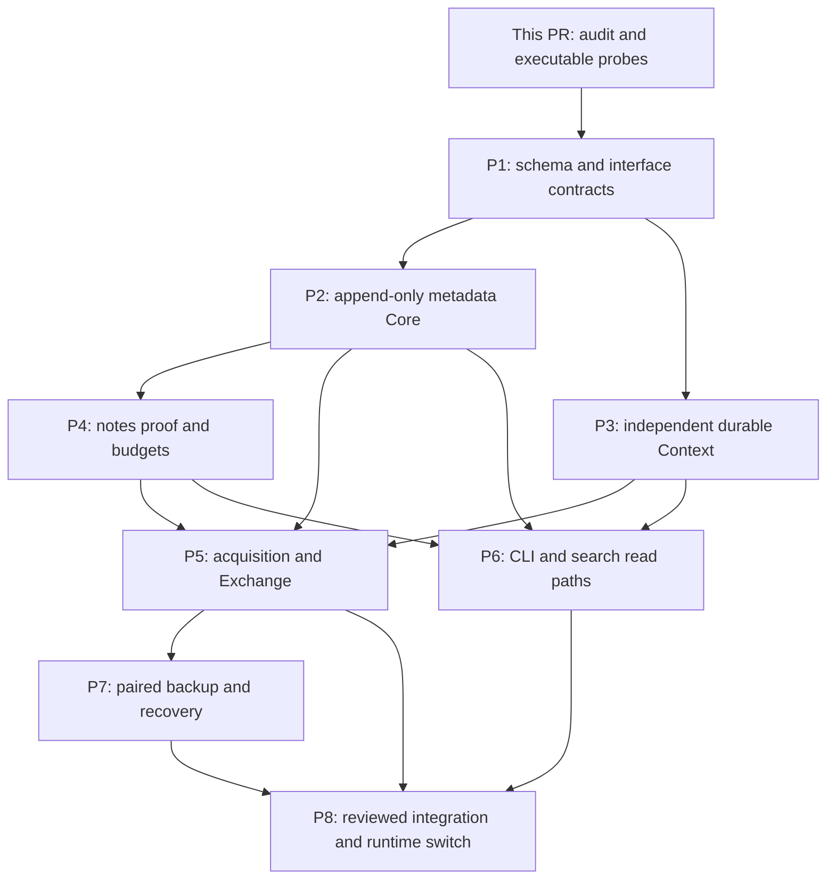

# Dependency-ordered implementation stack

Current status (2026-10-16): P1/P2/P3 are integrated on main `5e778bf`.
[P4 production Notes](p4-production-notes.md) is an opt-in implementation proposed
on a branch stacked over [design PR #77](https://github.com/TakashiSasaki/git-repo-db/pull/77).
P5/P6/P7/P8 remain separate, and the public initializer still uses Schema 21.
Historical planning and exact earlier execution reports retain their original scope.

This is the engineering handoff from the implementation-boundary spikes, not a
new policy ADR or authorization to perform production migration. The graph in
[implementation-stack.json](implementation-stack.json) is the machine-readable
source for dependencies, deliverables and acceptance boundaries.

## Coherent units and parallelism

P1 fixes interfaces, semantic keys and fresh DDL ownership before either domain
implementation. It should deliver a buildable isolated target schema and executable
contract tests, not flip the product initializer early. The table matrix is its
input checklist: every split column, uniqueness condition, FK and guard needs an
explicit successor or justified removal. A clean fresh format avoids migration
compatibility layers for the unfinished Schema 21 design. No source catalog is
extracted/deleted by this stack without separate authorization.

P2 and P3 can then proceed independently on the same fixed portable-identity and
snapshot contracts. P2 owns Git invariants; P3 owns Context current-state evidence.
Neither owns the other's validity. P4 extends P2's typed admission interfaces;
Context is not a prerequisite for notes. P5 integrates both authorities and notes,
while P6 can implement/query against stable domain interfaces in parallel. Its
final end-to-end review depends on P5 fixtures, but its implementation need not
wait for acquisition transport work. P7 needs the integrated typed admission and
replay contracts for salvage/merge. Backup snapshot helpers and stop fencing can
be developed earlier against P1/P2/P3 interfaces; final activation is reviewed with
P5. P8 is the coherent production integration boundary, including deletion of
obsolete mechanisms and installed schema checks. Review each substantial unit,
then independently review the effective integrated tree. Eight units are suggested
because they have different transaction/test responsibilities; combine units if
that preserves these boundaries, rather than splitting into trivial table PRs.

## Concrete interface work before implementation

- Core API accepts full typed nominal IDs and attributed typed claim/group values,
  with an immutable whole-group key and matching composite FK. Missing child bodies
  are not an FK-hydration task. Canonical read values require exact local intrinsic
  evidence; reported alternatives remain exposed.
- Context API uses true provider/service/resource identity, field-specific source
  clocks and current candidate alternatives. Its Core associations use portable
  identities and explicit evidence requirements, validated at the application
  boundary because SQLite cannot enforce cross-file FKs.
- Coverage keeps **exactly the existing five claim columns**. Scope/observation
  ownership becomes a real semantic composite, independent of those five values.
  Do not retain `coverage_scope_id`/`coverage_observation_id` as storage keys or
  invent observation UUIDs for joins. Derive a current candidate set from the
  actual source/collection/field evidence identity and clock; absence of adequate
  identity fails closed. Detailed candidate DDL is an engineering deliverable in
  P1/P3, with latest partial/unknown versus older complete tests.
- The supported connection boundary enables FK/recursive triggers and denies Core
  mutation/REPLACE, not just application methods named `update`. Privileged SQL
  cannot be made cryptographically trustworthy by DDL. Validate exact replay
  equality before ignoring duplicate inputs.
- Replace `local_revision` consumers by their actual needs: paging snapshot bound
  to a catalog instance, Context field-clock acquisition preconditions, derivative
  Search validity, or paired authoritative read fencing. An Operational counter
  can invalidate a cache conservatively; it cannot certify durable truth or become
  a missing-authority dependency after Operational loss. No Core counter-history
  ledger. Until a proven index fence exists, direct authority scans are correct.
- The conservative cross-store implementation uses one OS gate for supported
  writes and paired snapshot establishment. Core-first commits preserve independent
  Git evidence; Context commits atomically after validating required dependencies.
  A complete Context resource does not imply Git closure. Readers pin both snapshots
  while the gate excludes writers. Prototype B's process-death results justify
  this first implementation, not power-loss or production handover readiness.
- Backup/restore must bind **both** authorities for full scope, validate copied
  schema/domain/retained bytes, harden manifest/directory durability and atomically
  activate a fresh destination. Recovery stop must survive restart independently
  of broken Core and disposable Operational, without a quarantine counter or
  source mutation. Exact stop marker/instance locator is engineering work under
  ADR 0026; it is no new publication/domain authority.

## Evidence required at the integration boundary

Each unit must reconcile its affected entries in the table and call-site maps;
passing prototypes does not waive production integration tests. P5 needs external
input, partial/deferred dependencies and all intake body-retention boundaries.
P6 needs index/fallback equality, pair snapshot and paging tests. P7 needs journal
preservation, actual corruption, fresh restore and activation fault injection.
P8 needs installed DDL/fingerprints, semantic FK ownership, absence of removed
writers and an independent exact-tree review. Follow ADR 0001 for focused local
validation and lightweight development CI; full dual local/hosted release
qualification is separate and is not launched here.

## Decisions versus engineering work

Established: all accepted ADR boundaries through 0027, permanent repository UUID,
Capture pair, no storage-only surrogates, append-only metadata Core, unsigned
external reports, five-column Coverage, known-positive Source, no Publication,
role-proven notes retention and recovery stop/fresh restore/merge.

Recommended engineering choices: lossless whole-group semantic encoding; conservative
shared OS gate with pinned pair reads; Core-first dependent admission; final paired
backup artifact manifest. They may be refined under the same accepted semantics
with equivalent adversarial evidence. Exact DDL, resource numbers, wire grammar,
retry mechanics and fencing implementations are engineering tasks.

**Genuine owner-level architectural blockers identified: 0.** Future Context GC
GC-03/04 and enhanced origin authenticity remain deferred; they do not block this
stack. If a future implementation uncovers incompatible accepted persistent meanings,
isolate that stage and demonstrate the contradiction. Do not ask the owner to choose
routine counters, proof encodings or numeric defaults.
