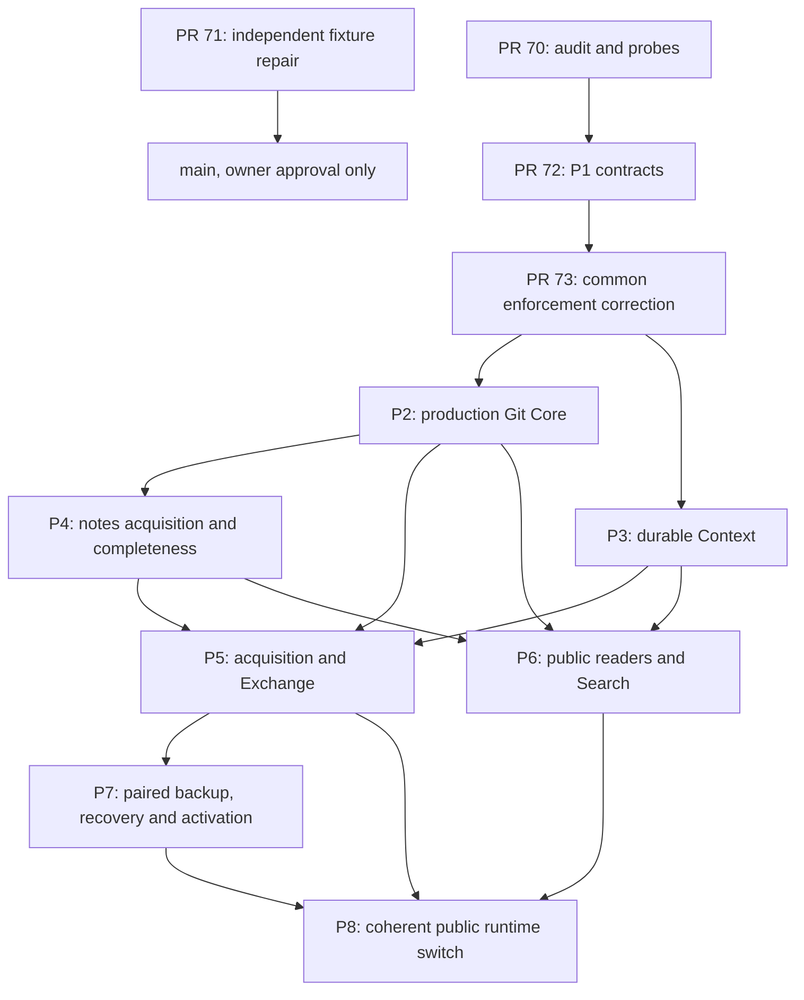

# Next-stage DAG after independently reviewed production siblings

The same corrected P1 dependency is common authority for both siblings. Their
branches remain separate; merge neither production PR as part of this task.

P4 may start on proposed `feat/p2-production-git-core` with common #73. It owns
complete notes acquisition, namespace inventory/completeness and durable actual-work
orchestration. P2 supplies selective native parsing, immutable Capture/report/group
and receiver-role/body admission; it does not claim complete notes acquisition.

P5 and P6 may begin against the stable P2/P3 interfaces and the committed combined
fixtures identified by [the compatibility report](p2-p3-compatibility.md). Their
complete notes/intake/query acceptance still depends on P4. P5 composes real
acquisition and Exchange, preserves original identity/provenance and honest partial
availability, and must not turn Provider input into hidden raw-response authority.
P6 owns public CLI/read/Search integration and end-to-end acquisition fixtures.

P7 needs integrated typed replay/admission from P5 for fresh verified restore,
untrusted salvage/merge and activation. Earlier synthetic backup/stop experiments
do not establish power-loss-safe recovery, filesystem journal preservation or real
catalog activation. P8 is the sole coherent initializer/runtime switch; Schema 21
remains active until that separately reviewed stage. No new real-data authorization
or release/deployment permission follows from this DAG.

Before owner-authorized integration, preserve merge commits in order #71 → #70 →
#72 → #73, revalidating exact heads/effective trees and acknowledging existing Pages
runs. Retarget both production siblings together after the common dependency lands;
never create P2→P3 or P3→P2 history merely to satisfy combined tests. Use the gated
plan and current GitHub settings; no auto-merge or direct main update.

Unresolved owner-level architectural blockers: **0**. Remaining parser/acquisition,
transport, public integration, resource mechanics and recovery/platform work are
stage engineering responsibilities, not reopened accepted architectural choices.
