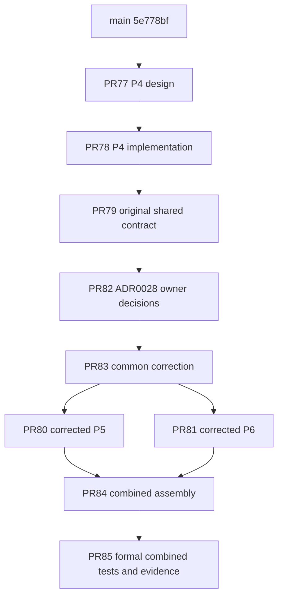

# Corrected P5/P6 integration and submission

## Result and exact input

Owner decisions are fixed in [ADR 0028](../adr/0028-classified-times-and-sha256-exchange.md)
and design [PR #82](https://github.com/TakashiSasaki/git-repo-db/pull/82).
They were explicitly accepted by the owner; no new PR is claimed approved or merged.
There are zero known owner-decision blockers and no open material finding in the
independently reviewed scope. Full Release Acceptance was not invoked.

The final **clean committed combined execution input** is
`0cb51d46d87d99c035f5162f4a7ed11970cf3b4c`, tree
`443c4b25478c1e406136c77d6689e87bd72231f9`.
The locked local run selected, executed and passed **1091 unique nodes**, with
zero failed, skipped or excluded nodes inside that selection. Collection,
exactly-once starts, JUnit identities and all three setup/call/teardown phases
reconcile. Code/test/build hashes stayed unchanged and the worktree was clean
before and after execution. See the [machine receipt](evidence/p5-p6-final-integration/final/receipt.json)
and [raw evidence entry](evidence/p5-p6-final-integration/README.md).

| Final selection | Actual nodes passed |
| --- | ---: |
| P1 shared/schema/time | 317 |
| P2 production Core | 197 |
| P3 production Context | 75 |
| P4 production Notes | 202 |
| P5 acquisition/Exchange | 47 |
| P6 query/Search/CLI | 50 |
| Existing P2/P3 compatibility | 20 |
| Formally collected P5/P6 compatibility | 29 |
| Architecture probes | 128 |
| Shared bounded snapshot regressions | 6 |
| P1–P6 installed wheel/sdist-wheel variants | 20 |
| **Unique total in this one run** | **1091** |

All requested locked sync, Ruff lint/format, schema build/fingerprint,
classification, implementation boundary and callsite audits passed. The additional
Publication-free audit passed. The receipt records exact argv, versions and
outputs. Distribution verification produced 18 archives: six direct wheels, six
sdists and six sdist-derived wheels. Actual hashes and member/source checks are
preserved, not inferred from a build exit code.

## Actual dependency DAG and formal integration path

- Common #83: `96db618285d5ce7b0d0c276d18f81bdbc50c34c1`.
- P5 #80: `48b60231b1ef7075c55ff6f43aca0c68ad95e5a8`.
- P6 #81: `76489443687123ef99fb33510c77fd40ce739d28`.
- Assembly #84: `f67e9298ff7915b4f7b1f0bef0c344f56d2cc064`, tree
  `2a575921267971f7b8d5296ed0fd939b9aa1a184`.
- Tests-only #85: branch `test/p5-p6-corrected-compatibility`, explicitly based on
  `validation/p5-p6-corrected-assembly` (#84), depending on **both** siblings.

PR #84 remains a **draft review-only assembly**, not a proposal to merge both
implementations into shared #83. After separately authorized sibling integration,
retarget the reviewed tests-only PR to the actual integrated base; do not merge
#84 into #83 and thereby contaminate the common dependency. PR #85 is the formal
tests/evidence review. No integration to main is authorized in this task.

Both siblings contain the same common commit and neither contains the other's
initial or corrected implementation commits. The original #80/#81 were advanced
with ordinary fast-forward pushes and retargeted together to #83. No force push,
main merge or history reset was used. The independent [DAG/tree check](evidence/p5-p6-final-integration/independent/dag-and-tree-review.json)
checks actual refs. Assembly versus tested input differs by exactly five files
under `tests/integration/p5_p6_compatibility/`, with **no production difference**.
This directory is formally in PR #85, not left only on the old validation branch.
The evidence/prose follow-up adds no runtime or test change; its exact342 scoped
input hashes are [preserved](evidence/p5-p6-final-integration/runtime-test-build-input-identity.json).
Final submitted SHA/tree are reported in the PR/owner handoff after committing,
so this file does not invent its own future commit hash.

## Findings and independent closure

Detailed per-finding reproduction/refutation, root cause, code fix, regression
and corrected-SHA independent execution are in the linked reports below.

| Responsibility | Reproduction or refutation → correction → independent recheck |
| --- | --- |
| Shared time/DDL | Positive-or-NULL observations/Provider times, required positive Coverage/terminal coordinates and signed native Git clocks enforced consistently. PK/FK and five-column Coverage meaning preserved; opt-in fingerprints/disposition updated. Real negative/zero native commit/tag bytes checked in both formats. The new snapshot factory's wrong-directory stop routing was independently reproduced, corrected and rerun. [Shared report](p5-p6-shared-time-correction.md); full828-node earlier source run, final focused119 plus independent74, later fixture-purpose2-node check are overlapping selections, not an additive total. |
| P5 A | Missing observation→0 and fabricated Provider/provenance coordinates reproduced. Nullable observations plus explicit genuine registration/identity/provenance preserve missing versus null. Six arrival-order permutations already passed the old implementation: those suspicions were refuted, not counted as fixes. |
| P5 B/C | Unbounded refs, post-input accounting, free Operational recreation and retry UUID changes reproduced. Prepaid bounded readers and actual repeated parsing/proof/text work; request-start witnesses outside disposable SQLite; same old request refuses recreation even with repeated initial flags; stable preallocated discovery/copy identity. Accepted reads do not depend on Operational. |
| P5 D/E | Selected OID promoted repository completeness and Git subprocess ran under Core callback; Exchange lost partial outcome. Conservative repository Coverage and Notes partial/unknown propagation, bounded typed preparation outside short Core transaction, preserved Core-first/Context-second AdmissionFailure outcome. |
| P5 F | Declared digest was absent, export snapshot was opened/closed before extraction, and completion stop was missed. SHA-256-only v2 compares declaration; portable attribution/replay preserved, byte/Notes checks stay receiver-local; export gate and completion stop fixed. Actual nonblocking process lock probe independently verifies the between-store cut. [P5 mapping](p5-owner-corrections.md), [independent9-finding report](evidence/p5-correction/independent/review.md). Independent corrected c90e9b1 execution64 passed (47 formal+17 reviewer), author160 and clean archived distribution4 are separate overlapping results. |
| P6 A | Ordinary instr/full authority extraction is honestly a bounded verified scan, **not FTS5 acceleration**. Literal Japanese/short/special/Unicode, empty refusal and binary Notes escaped presentation tested; missing/stale/incomplete/large/corrupt Search falls back without authority stop. Deep derivative JSON falsely causing a stop was independently reproduced and corrected. |
| P6 B | Rechecksummed malformed cursors and full-view materialize/sort reproduced. Typed endpoint/key/catalog/snapshot/filter validation, finite budgets and heap of limit+1 replace unbounded retention. Exact counts and token generation still perform bounded scans; no keyset/FTS speed claim. |
| P6 C | Private fabricated capability/expiry, malformed JSON/UTF-8/typed values/provenance without stop and binary Notes failures reproduced. Supported owner-bound expiring readers, complete stored-row decode boundaries and durable stop corrected. Metadata-only queries avoid all-body retrieval/rehash. [P6 mapping](p6-corrections.md); independent corrected df912d6 execution82 unique/246 phases passed (50 formal+6 shared+26 adversarial). |
| Final integration/evidence | Separate read-only reviewer executed49 unique nodes on final0cb51d4:29 combined+20 existing compatibility,147 phases passed. Independently checked actual siblings/assembly/tree and final receipts/distributions. These49 overlap1091 and are **not summed**. [Reviewer evidence](evidence/p5-p6-final-integration/independent/). |

The original P5 790 prose was an arithmetic error:20+4+762=786, matching the old
historical receipt. Old HMAC/“signed”/FTS/nonexistent API/test/CLI assertions have
been corrected in active documents and PR descriptions; old receipts keep their
original meaning. No HMAC, signature, PKI or key management was added. Data plus
checksum replacement can impersonate a sender; local domain/Notes/native-OID
validation remains necessary after package checksum equality.

## Regression purpose and preserved failures

[Old→expanded node mapping](evidence/p5-p6-final-integration/test-purpose-mapping.json)
preserves the original five combined purposes in both Git formats. New tests cover
actual Notes, Context-before-Git, partial/reordered/repeat/reverse/onward Exchange,
NULL/incomparable clocks, exact Search hit equality, Operational/Search loss and
persistent authoritative-corruption stop. Native pre-epoch synthetic fixtures use
`git hash-object --literally` because Git's normal producer rejects them; this is
not a claim that git fsck accepts the constructed date.

An initial clean combined run at0088a3d executed1090 nodes:1086 passed, four P5
installed tests failed because the fixture omitted the now-required explicit
Operational ledger. The fixture was corrected at2833e50, preserving all four
original node IDs/purposes. Final0cb51d4 reruns the complete selection with that
fix plus the additional real-lock regression, and passes1091. The earlier failed
run is [preserved separately](evidence/p5-p6-final-integration/intermediate-0088/receipt.json),
not relabeled. Shared0→1 observation fixture edits retain their original negative
constraint target; the late missing-clock test fix prevents another CHECK masking
its intended failure.

Exactly **five inherited Schema21 fixture failures remain**. They were executed
on unchanged main5e778bf and again on final0cb51d4; node identities and missing-table
classification are identical: cache_leases1, jobs3, cache_locators1. [Classification](evidence/p5-p6-final-integration/inherited-fixture-classification.json)
and both raw JUnit/journals are retained. No delete, skip or xfail hides them.
They are outside the1091 selection and reported as failed, never as waived PASS.

## Development CI, packaging and remaining limits

- Hosted Development CI on tested0cb51d4: [run38860098880](https://github.com/TakashiSasaki/git-repo-db/actions/runs/38860098880),
  `development_checks_passed`, `full_acceptance=false`, **0 runtime nodes**. The
  bounded log ZIP and21 indexed SHA/size entries were verified. Its temporary PR
  merge47e051f6 has the exact same effective tree443c4b25 as the tested feature.
  [Binding and summary](evidence/p5-p6-final-integration/hosted-development/verification-summary.json).
- Local1091, installed distribution20 variants, independent shared/P5/P6/final
  review and hosted Development CI are separate evidence. Green CI alone proves
  none of the local combined or distribution execution.
- Evidence additions can change scripts.ci_plan's live acceptance_input_hash.
  The342-file runtime/test/build identity deliberately has a narrower explicit
  scope; it is **not** a claim that the live CI acceptance hash remained equal.
  No policy/audit was weakened to hide evidence. The tested live hash is
  `60c94caae7eed9d7045ccf98127481da31a1100f93ae54b2f588c65096d3535b`;
  the submitted live hash is reported after commit in PR #85.
- Actual [phase telemetry](evidence/p5-p6-final-integration/final/phase-costs.json)
  separately measures snapshot token generation, authority validation, derivative
  scan and authoritative search extraction in three synthetic topologies. These
  are diagnostic timings, not controlled comparative benchmarks or an FTS speedup.
- Full Release Acceptance, complete legacy suites, authenticated live acquisition,
  P7 recovery/salvage/activation, host power-loss acceptance and P8 runtime switching
  were not run. P7 was not started; P8 is unchanged. Search acceleration remains
  unimplemented, with conservative bounded correct scans intentionally retained.

Public Schema21 CLI/initializer/resource bytes are [unchanged from main](evidence/p5-p6-final-integration/public-schema21-unchanged.json).
No real catalog/backup was inspected or changed; only disposable synthetic fixtures
were used. No main update/PR-to-main merge, auto-merge, force push, release/tag,
protection bypass or intentional Pages publication occurred. Existing automatic
PR documentation builds are not a runtime switch or permission to merge.

Verified procedures were recorded in the existing
[three-store-invariants skill](../../.agents/skills/three-store-invariants/SKILL.md):
request-loss witnesses/identity, actual lock contenders, full stored-row decode
boundaries, derivative preallocation/depth handling, and clean distribution input
hygiene. ADR workflow, exact-tree CI and lessons-to-skills procedures were used;
no unexecuted PASS or speculative recovery technique was promoted to a skill.
