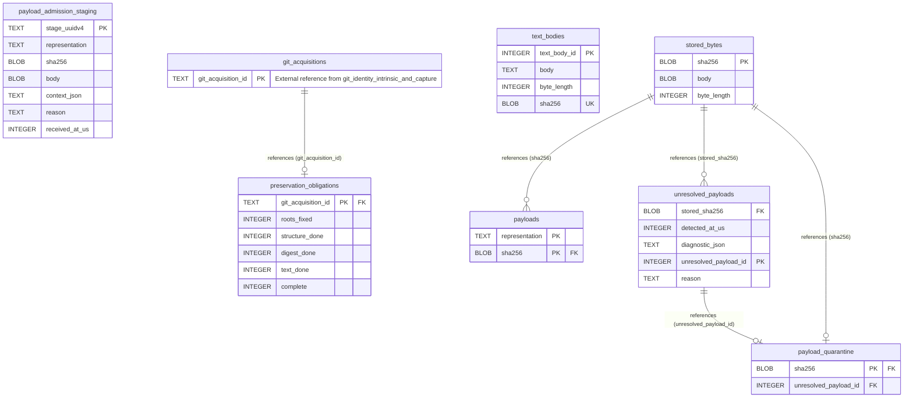

# Core Module: Retained Content Integrity & CAS

Shared CAS payload storage, quarantine, unreferenced bodies, and durable preservation obligations.

- **Store:** Core (`catalog.sqlite3`)
- **Module Tables:** 7

## Cross-Module Foreign Keys

| Source Table | Source Column(s) | Target Table | Target Column(s) | Target Module | Action |
|---|---|---|---|---|---|
| `preservation_obligations` | `git_acquisition_id` | [`git_acquisitions`](core-git.md) | `git_acquisition_id` | Git Identity, Intrinsic DAG & Capture | ON UPDATE RESTRICT, ON DELETE RESTRICT |

[Back to Core Overview](core-overview.md) | [Back to Architecture Overview](overview.md)
