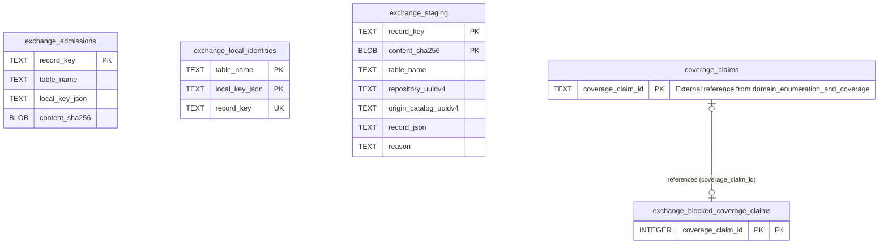

# Core Module: Exchange Staging & Admissions

Staging area for catalog synchronization, admission receipts, and conflicting candidate resolution.

- **Store:** Core (`catalog.sqlite3`)
- **Module Tables:** 4

## Cross-Module Foreign Keys

| Source Table | Source Column(s) | Target Table | Target Column(s) | Target Module | Action |
|---|---|---|---|---|---|
| `exchange_blocked_coverage_claims` | `coverage_claim_id` | [`coverage_claims`](core-coverage.md) | `coverage_claim_id` | Domain Enumeration & Coverage Evidence | ON UPDATE NO ACTION, ON DELETE NO ACTION |

[Back to Core Overview](core-overview.md) | [Back to Architecture Overview](overview.md)
