# Core Module: Git Identity, Intrinsic DAG & Capture

Immutable Git acquisitions, snapshots, objects, commits, trees, tags, ref observations, and byte facts.

- **Store:** Core (`catalog.sqlite3`)
- **Module Tables:** 21

```mermaid
erDiagram
    acquisition_roots {
        INTEGER acquisition_root_id PK
        TEXT git_acquisition_id FK
        TEXT repository_uuidv4 FK
        TEXT object_format
        BLOB oid
        TEXT role
        BLOB expected_oid "nullable"
        INTEGER complete
    }

    blob_content_map {
        INTEGER git_object_id PK "FK"
        INTEGER content_id FK
    }

    commit_parents {
        INTEGER commit_git_object_id PK "FK"
        INTEGER parent_ordinal PK
        INTEGER parent_header_offset
        TEXT parent_format
        BLOB parent_oid
        INTEGER parent_git_object_id FK "nullable"
    }

    commits {
        INTEGER git_object_id PK "FK"
        TEXT tree_format
        BLOB tree_oid
        INTEGER tree_git_object_id FK "nullable"
        INTEGER tree_header_offset
        INTEGER parent_count
        BLOB raw_headers
        BLOB raw_message
    }

    content_digests {
        INTEGER content_id PK "FK"
        TEXT representation PK
        TEXT algorithm PK
        BLOB digest
        INTEGER verified_at_us "nullable"
        TEXT pipeline_version
    }

    contents {
        INTEGER content_id PK
        INTEGER byte_length
        INTEGER created_at_us "nullable"
    }

    git_acquisitions {
        TEXT git_acquisition_id PK
        TEXT repository_uuidv4 FK
        TEXT repository_endpoint_id FK "nullable"
        TEXT endpoint_url "nullable"
        TEXT object_format "nullable"
        INTEGER refs_observed_at_us "nullable"
        TEXT source_id FK "nullable"
        TEXT kind
        INTEGER started_at_us "nullable"
        INTEGER observed_at_us "nullable"
        TEXT request
        TEXT roots_manifest "nullable"
    }

    git_commit_facts {
        TEXT git_fact_uuidv4 PK
        INTEGER git_object_id FK
        TEXT decoder_key
        TEXT parser_module
        TEXT parser_version
        TEXT metadata_encoding
        TEXT metadata_errors
        TEXT text_encoding
        INTEGER max_text_blob_bytes
        TEXT message_text
        TEXT metadata
    }

    git_name_facts {
        INTEGER tree_git_object_id PK "FK"
        BLOB raw_name PK "FK"
        TEXT decoder_key PK
        TEXT parser_module
        TEXT parser_version
        TEXT metadata_encoding
        TEXT metadata_errors
        TEXT text_encoding
        INTEGER max_text_blob_bytes
        TEXT decoded_name
    }

    git_object_payloads {
        INTEGER git_object_id PK "FK"
        TEXT payload_representation FK
        BLOB payload_sha256 FK
    }

    git_objects {
        INTEGER git_object_id PK
        TEXT object_format
        BLOB oid
        TEXT type
        INTEGER size
        INTEGER verified
    }

    git_text_facts {
        TEXT git_fact_uuidv4 PK
        INTEGER git_object_id FK
        INTEGER content_id FK
        TEXT decoder_key
        TEXT parser_module
        TEXT parser_version
        TEXT text_encoding
        INTEGER max_text_blob_bytes
        TEXT metadata_encoding
        TEXT metadata_errors
        TEXT text_state
        TEXT raw_text "nullable"
    }

    ref_observations {
        TEXT repository_uuidv4 FK
        TEXT snapshot_id PK "FK"
        BLOB raw_ref_name PK
        TEXT kind
        TEXT object_format
        BLOB target_oid
        BLOB peeled_oid "nullable"
        TEXT target_type "nullable"
    }

    repository_object_sources {
        TEXT repository_uuidv4 PK "FK"
        INTEGER git_object_id PK "FK"
        TEXT git_acquisition_id PK "FK"
    }

    root_manifest_entries {
        INTEGER tree_git_object_id PK "FK"
        BLOB raw_path PK
        INTEGER mode
        INTEGER git_object_id FK "nullable"
        TEXT object_format
        BLOB oid
    }

    root_manifests {
        INTEGER tree_git_object_id PK "FK"
        INTEGER complete
        INTEGER entry_count
    }

    root_origins {
        INTEGER root_origin_id PK
        INTEGER acquisition_root_id FK
        TEXT repository_uuidv4 FK
        TEXT origin_kind
        BLOB raw_ref_name "nullable"
        INTEGER source_ordinal
        TEXT snapshot_id FK "nullable"
        TEXT change_request_id FK "nullable"
        TEXT code_assessment_id FK "nullable"
    }

    snapshots {
        TEXT snapshot_id PK
        TEXT git_acquisition_id FK
        TEXT repository_uuidv4 FK
        TEXT predecessor_snapshot_id FK "nullable"
        INTEGER complete
        INTEGER generation
        INTEGER created_at_us "nullable"
    }

    tag_objects {
        INTEGER git_object_id PK "FK"
        TEXT target_format
        BLOB target_oid
        TEXT target_type
        INTEGER target_git_object_id FK "nullable"
        BLOB raw_payload
    }

    tree_entries {
        INTEGER tree_git_object_id PK "FK"
        BLOB raw_name PK
        INTEGER entry_offset
        INTEGER entry_length
        INTEGER mode
        TEXT child_format
        BLOB child_oid
        INTEGER child_git_object_id FK "nullable"
    }

    tree_objects {
        INTEGER git_object_id PK "FK"
        INTEGER entry_count
    }

    change_requests {
        TEXT change_request_id PK "External reference from portable_identity_and_registration"
    }

    code_assessments {
        TEXT code_assessment_id PK "External reference from domain_enumeration_and_coverage"
    }

    payloads {
        TEXT representation PK "External reference from retained_content_integrity"
        TEXT sha256 PK "External reference from retained_content_integrity"
    }

    repositories {
        TEXT repository_uuidv4 PK "External reference from portable_identity_and_registration"
    }

    repository_endpoints {
        TEXT repository_endpoint_id PK "External reference from portable_identity_and_registration"
    }

    sources {
        TEXT source_id PK "External reference from portable_identity_and_registration"
    }

    acquisition_roots ||--o{ root_origins : "references (acquisition_root_id, repository_uuidv4)"
    change_requests |o--o{ root_origins : "references (change_request_id, repository_uuidv4)"
    code_assessments |o--o{ root_origins : "references (code_assessment_id, change_request_id)"
    commits ||--o{ commit_parents : "references (commit_git_object_id)"
    commits ||--o{ git_commit_facts : "references (git_object_id)"
    contents ||--o{ blob_content_map : "references (content_id)"
    contents ||--o{ content_digests : "references (content_id)"
    contents ||--o{ git_text_facts : "references (content_id)"
    git_acquisitions ||--o{ acquisition_roots : "references (git_acquisition_id, repository_uuidv4)"
    git_acquisitions ||--o{ repository_object_sources : "references (git_acquisition_id, repository_uuidv4)"
    git_acquisitions ||--o{ snapshots : "references (git_acquisition_id, repository_uuidv4)"
    git_objects |o--o{ commit_parents : "references (parent_git_object_id)"
    git_objects |o--o{ commits : "references (tree_git_object_id)"
    git_objects |o--o{ root_manifest_entries : "references (git_object_id)"
    git_objects |o--o{ tag_objects : "references (target_git_object_id)"
    git_objects |o--o{ tree_entries : "references (child_git_object_id)"
    git_objects |o--o| blob_content_map : "references (git_object_id)"
    git_objects |o--o| commits : "references (git_object_id)"
    git_objects |o--o| git_object_payloads : "references (git_object_id)"
    git_objects |o--o| tag_objects : "references (git_object_id)"
    git_objects |o--o| tree_objects : "references (git_object_id)"
    git_objects ||--o{ git_text_facts : "references (git_object_id)"
    git_objects ||--o{ repository_object_sources : "references (git_object_id)"
    payloads ||--o{ git_object_payloads : "references (payload_representation, payload_sha256)"
    repositories ||--o{ git_acquisitions : "references (repository_uuidv4)"
    repositories ||--o{ repository_object_sources : "references (repository_uuidv4)"
    repository_endpoints |o--o{ git_acquisitions : "references (repository_endpoint_id, repository_uuidv4)"
    root_manifests ||--o{ root_manifest_entries : "references (tree_git_object_id)"
    snapshots |o--o{ root_origins : "references (snapshot_id, repository_uuidv4)"
    snapshots |o--o{ snapshots : "references (predecessor_snapshot_id, repository_uuidv4)"
    snapshots ||--o{ ref_observations : "references (snapshot_id, repository_uuidv4)"
    sources |o--o{ git_acquisitions : "references (source_id)"
    tree_entries ||--o{ git_name_facts : "references (tree_git_object_id, raw_name)"
    tree_objects |o--o| root_manifests : "references (tree_git_object_id)"
    tree_objects ||--o{ tree_entries : "references (tree_git_object_id)"
```

## Cross-Module Foreign Keys

| Source Table | Source Column(s) | Target Table | Target Column(s) | Target Module | Action |
|---|---|---|---|---|---|
| `git_acquisitions` | `repository_endpoint_id, repository_uuidv4` | [`repository_endpoints`](core-identity.md) | `repository_endpoint_id, repository_uuidv4` | Portable Identity & Registration | ON UPDATE NO ACTION, ON DELETE NO ACTION |
| `git_acquisitions` | `source_id` | [`sources`](core-identity.md) | `source_id` | Portable Identity & Registration | ON UPDATE NO ACTION, ON DELETE NO ACTION |
| `git_acquisitions` | `repository_uuidv4` | [`repositories`](core-identity.md) | `repository_uuidv4` | Portable Identity & Registration | ON UPDATE NO ACTION, ON DELETE NO ACTION |
| `git_object_payloads` | `payload_representation, payload_sha256` | [`payloads`](core-cas.md) | `representation, sha256` | Retained Content Integrity & CAS | ON UPDATE NO ACTION, ON DELETE NO ACTION |
| `repository_object_sources` | `repository_uuidv4` | [`repositories`](core-identity.md) | `repository_uuidv4` | Portable Identity & Registration | ON UPDATE NO ACTION, ON DELETE NO ACTION |
| `root_origins` | `code_assessment_id, change_request_id` | [`code_assessments`](core-coverage.md) | `code_assessment_id, change_request_id` | Domain Enumeration & Coverage Evidence | ON UPDATE NO ACTION, ON DELETE NO ACTION |
| `root_origins` | `change_request_id, repository_uuidv4` | [`change_requests`](core-identity.md) | `change_request_id, repository_uuidv4` | Portable Identity & Registration | ON UPDATE NO ACTION, ON DELETE NO ACTION |

[Back to Core Overview](core-overview.md) | [Back to Architecture Overview](overview.md)
