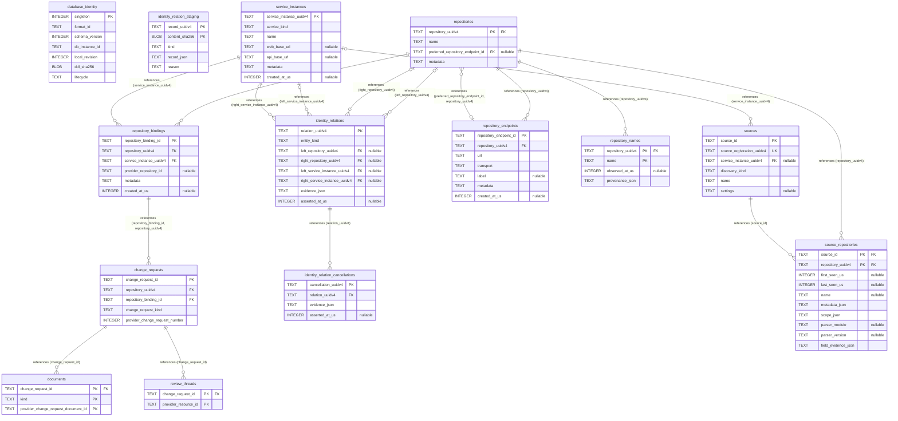

# Core Module: Portable Identity & Registration

Portable UUIDv4 identities, service instances, sources, repositories, bindings, change requests, and identity relations.

- **Store:** Core (`catalog.sqlite3`)
- **Module Tables:** 14

[Back to Core Overview](core-overview.md) | [Back to Architecture Overview](overview.md)
