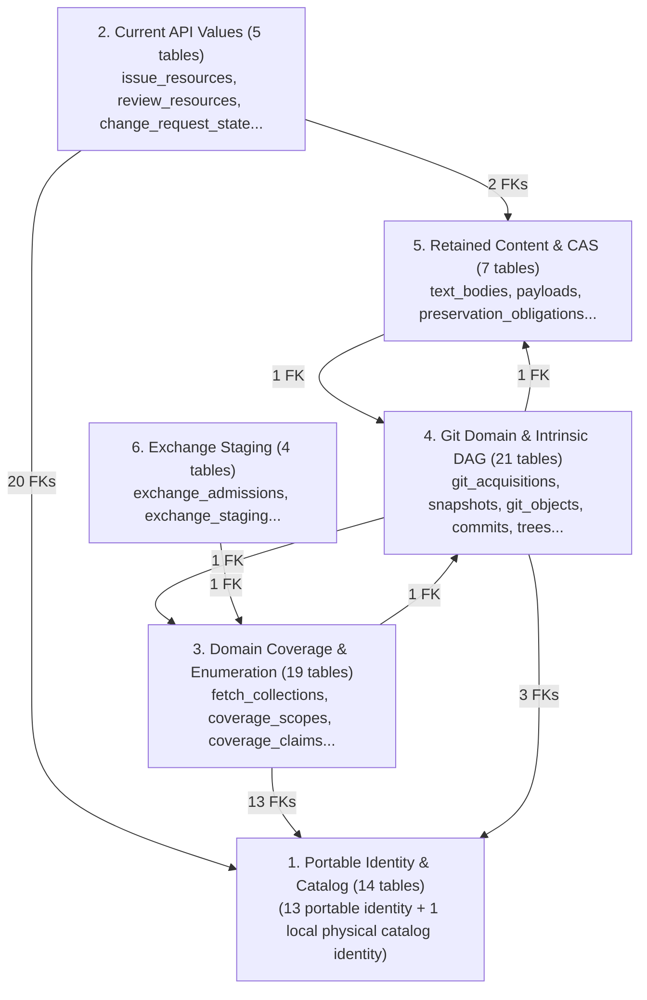

# Core Store Schema Overview (catalog.sqlite3)

Authoritative domain facts, entities, observations, and evidence under **Core Schema Version 21**.

- **Physical Database:** `catalog.sqlite3`
- **DDL SHA-256:** `8ee2631fe083e26cd0346bc71a8a5d1f4d7dab4bf661958d6406c885bc553ff0`
- **Product Tables:** 70
- **Views:** 20
- **Triggers:** 512
- **Physical Foreign Keys:** 121
- **Explicit Indexes:** 46

## High-Level Module Dependency Map

The 70 Core tables are partitioned into 7 cohesive functional categories (presented across 6 modular ER diagrams, with Local Physical Catalog Identity grouped alongside Portable Identity & Registration). SQLite foreign keys connect these modules hierarchically:

## Functional Modules Directory

| Category / Module | Tables | Detailed Diagram | Description |
|---|---|---|---|
| **Portable Identity & Registration** | 13 | [core-identity.md](core-identity.md) | Universal portable identities, Sources, repositories, bindings, endpoints, and identity relations. |
| **Local Physical Catalog Identity** | 1 | [core-identity.md](core-identity.md) | Local SQLite database singleton and receiver-local revision counter (`database_identity`, grouped into core-identity diagram). |
| **Current API Values** | 5 | [core-current-state.md](core-current-state.md) | Current PR/Issue/thread observation states, resource projections, and generated column contracts. |
| **Domain Coverage & Enumeration** | 19 | [core-coverage.md](core-coverage.md) | API collections, memberships, typed coverage claims/scopes, and code listing evidence. |
| **Git Domain & Intrinsic DAG** | 21 | [core-git.md](core-git.md) | Git acquisitions, snapshots, objects, tree entries, commit DAG, and verified byte facts. |
| **Retained Content & CAS** | 7 | [core-cas.md](core-cas.md) | Shared CAS storage, verified payloads, quarantine, and durable preservation obligations. |
| **Exchange Staging & Admissions** | 4 | [core-exchange.md](core-exchange.md) | Inter-catalog sync staging, admission receipts, and conflicting candidate resolution. |

## Complete Core Table Inventory

| Table Name | Module | Columns | Primary Key | Outgoing FKs | Incoming FKs | Strict |
|---|---|---|---|---|---|---|
| `acquisition_roots` | Git Identity, Intrinsic DAG & Capture | 8 | `acquisition_root_id` | 1 | 2 | Yes |
| `blob_content_map` | Git Identity, Intrinsic DAG & Capture | 2 | `git_object_id` | 2 | 0 | Yes |
| `change_request_events` | Domain Enumeration & Coverage Evidence | 13 | `change_request_event_uuidv4` | 1 | 0 | Yes |
| `change_request_state` | Current API Values & Projections | 33 | `change_request_id` | 7 | 0 | Yes |
| `change_requests` | Portable Identity & Registration | 5 | `change_request_id` | 1 | 13 | Yes |
| `code_acquisitions` | Domain Enumeration & Coverage Evidence | 5 | `code_assessment_id, role` | 2 | 0 | Yes |
| `code_assessments` | Domain Enumeration & Coverage Evidence | 13 | `code_assessment_id` | 3 | 2 | Yes |
| `code_commits` | Domain Enumeration & Coverage Evidence | 6 | `code_listing_id, position` | 2 | 0 | Yes |
| `code_file_changes` | Domain Enumeration & Coverage Evidence | 14 | `code_listing_id, position` | 2 | 0 | Yes |
| `code_listing_progress` | Domain Enumeration & Coverage Evidence | 5 | `code_listing_id` | 1 | 0 | Yes |
| `code_listings` | Domain Enumeration & Coverage Evidence | 8 | `code_listing_id` | 1 | 5 | Yes |
| `collection_memberships` | Domain Enumeration & Coverage Evidence | 5 | `fetch_collection_id, change_request_id, kind, provider_change_request_document_id` | 2 | 0 | Yes |
| `commit_parents` | Git Identity, Intrinsic DAG & Capture | 6 | `commit_git_object_id, parent_ordinal` | 2 | 0 | Yes |
| `commits` | Git Identity, Intrinsic DAG & Capture | 8 | `git_object_id` | 2 | 2 | Yes |
| `completion_markers` | Domain Enumeration & Coverage Evidence | 7 | `completion_marker_id` | 1 | 1 | Yes |
| `content_digests` | Git Identity, Intrinsic DAG & Capture | 6 | `content_id, representation, algorithm` | 1 | 0 | Yes |
| `contents` | Git Identity, Intrinsic DAG & Capture | 3 | `content_id` | 0 | 3 | Yes |
| `coverage_claim_markers` | Domain Enumeration & Coverage Evidence | 2 | `coverage_claim_id, completion_marker_uuidv4` | 2 | 0 | Yes |
| `coverage_claims` | Domain Enumeration & Coverage Evidence | 5 | `coverage_claim_id` | 1 | 2 | Yes |
| `coverage_scopes` | Domain Enumeration & Coverage Evidence | 4 | `coverage_scope_id` | 2 | 1 | Yes |
| `current_collection_pages` | Domain Enumeration & Coverage Evidence | 8 | `fetch_collection_id, ordinal` | 1 | 0 | Yes |
| `database_identity` | Local Physical Catalog Identity | 7 | `singleton` | 0 | 0 | Yes |
| `document_state` | Current API Values & Projections | 21 | `change_request_id, kind, provider_change_request_document_id` | 6 | 0 | Yes |
| `documents` | Portable Identity & Registration | 3 | `change_request_id, kind, provider_change_request_document_id` | 1 | 2 | Yes |
| `exchange_admissions` | Exchange Staging & Admissions | 4 | `record_key` | 0 | 0 | Yes |
| `exchange_blocked_coverage_claims` | Exchange Staging & Admissions | 1 | `coverage_claim_id` | 1 | 0 | Yes |
| `exchange_local_identities` | Exchange Staging & Admissions | 3 | `table_name, local_key_json` | 0 | 0 | Yes |
| `exchange_staging` | Exchange Staging & Admissions | 7 | `record_key, content_sha256` | 0 | 0 | Yes |
| `fetch_collections` | Domain Enumeration & Coverage Evidence | 8 | `fetch_collection_id` | 3 | 8 | Yes |
| `git_acquisitions` | Git Identity, Intrinsic DAG & Capture | 12 | `git_acquisition_id` | 3 | 4 | Yes |
| `git_commit_facts` | Git Identity, Intrinsic DAG & Capture | 11 | `git_fact_uuidv4` | 1 | 0 | Yes |
| `git_name_facts` | Git Identity, Intrinsic DAG & Capture | 10 | `tree_git_object_id, raw_name, decoder_key` | 1 | 0 | Yes |
| `git_object_payloads` | Git Identity, Intrinsic DAG & Capture | 3 | `git_object_id` | 2 | 0 | Yes |
| `git_objects` | Git Identity, Intrinsic DAG & Capture | 6 | `git_object_id` | 0 | 12 | Yes |
| `git_text_facts` | Git Identity, Intrinsic DAG & Capture | 12 | `git_fact_uuidv4` | 2 | 0 | Yes |
| `identity_relation_cancellations` | Portable Identity & Registration | 4 | `cancellation_uuidv4` | 1 | 0 | Yes |
| `identity_relation_staging` | Portable Identity & Registration | 5 | `record_uuidv4, content_sha256` | 0 | 0 | Yes |
| `identity_relations` | Portable Identity & Registration | 8 | `relation_uuidv4` | 4 | 1 | Yes |
| `issue_resources` | Current API Values & Projections | 25 | `service_instance_uuidv4, kind, provider_resource_id` | 5 | 1 | Yes |
| `payload_admission_staging` | Retained Content Integrity & CAS | 7 | `stage_uuidv4` | 0 | 0 | Yes |
| `payload_quarantine` | Retained Content Integrity & CAS | 2 | `sha256` | 2 | 0 | Yes |
| `payloads` | Retained Content Integrity & CAS | 2 | `representation, sha256` | 1 | 1 | Yes |
| `preservation_obligations` | Retained Content Integrity & CAS | 6 | `git_acquisition_id` | 1 | 0 | Yes |
| `ref_observations` | Git Identity, Intrinsic DAG & Capture | 8 | `snapshot_id, raw_ref_name` | 1 | 0 | Yes |
| `repositories` | Portable Identity & Registration | 4 | `repository_uuidv4` | 1 | 18 | Yes |
| `repository_bindings` | Portable Identity & Registration | 6 | `repository_binding_id` | 2 | 9 | Yes |
| `repository_endpoints` | Portable Identity & Registration | 7 | `repository_endpoint_id` | 1 | 2 | Yes |
| `repository_names` | Portable Identity & Registration | 4 | `repository_uuidv4, name` | 1 | 0 | Yes |
| `repository_object_sources` | Git Identity, Intrinsic DAG & Capture | 3 | `repository_uuidv4, git_object_id, git_acquisition_id` | 3 | 0 | Yes |
| `resume_scopes` | Domain Enumeration & Coverage Evidence | 10 | `resume_scope_id` | 3 | 0 | Yes |
| `review_resources` | Current API Values & Projections | 34 | `change_request_id, kind, provider_change_request_document_id` | 9 | 2 | Yes |
| `review_thread_state` | Current API Values & Projections | 29 | `change_request_id, provider_resource_id` | 5 | 0 | Yes |
| `review_threads` | Portable Identity & Registration | 2 | `change_request_id, provider_resource_id` | 1 | 2 | Yes |
| `root_manifest_entries` | Git Identity, Intrinsic DAG & Capture | 6 | `tree_git_object_id, raw_path` | 2 | 0 | Yes |
| `root_manifests` | Git Identity, Intrinsic DAG & Capture | 3 | `tree_git_object_id` | 1 | 1 | Yes |
| `root_origins` | Git Identity, Intrinsic DAG & Capture | 9 | `root_origin_id` | 4 | 0 | Yes |
| `service_instances` | Portable Identity & Registration | 7 | `service_instance_uuidv4` | 0 | 9 | Yes |
| `snapshots` | Git Identity, Intrinsic DAG & Capture | 7 | `snapshot_id` | 2 | 3 | Yes |
| `source_inventory_assessments` | Domain Enumeration & Coverage Evidence | 10 | `source_id, scope_json, observed_at_us, state, terminal, members_json` | 1 | 0 | Yes |
| `source_repositories` | Portable Identity & Registration | 10 | `source_id, repository_uuidv4` | 2 | 0 | Yes |
| `sources` | Portable Identity & Registration | 6 | `source_id` | 1 | 5 | Yes |
| `stored_bytes` | Retained Content Integrity & CAS | 3 | `sha256` | 0 | 3 | Yes |
| `tag_objects` | Git Identity, Intrinsic DAG & Capture | 6 | `git_object_id` | 2 | 0 | Yes |
| `text_bodies` | Retained Content Integrity & CAS | 4 | `text_body_id` | 0 | 3 | Yes |
| `thread_collection_continuations` | Domain Enumeration & Coverage Evidence | 4 | `fetch_collection_id, provider_resource_id` | 1 | 0 | Yes |
| `thread_collection_requirements` | Domain Enumeration & Coverage Evidence | 7 | `fetch_collection_id, provider_resource_id` | 2 | 0 | Yes |
| `thread_collection_targets` | Domain Enumeration & Coverage Evidence | 5 | `fetch_collection_id, role` | 1 | 0 | Yes |
| `tree_entries` | Git Identity, Intrinsic DAG & Capture | 8 | `tree_git_object_id, raw_name` | 2 | 1 | Yes |
| `tree_objects` | Git Identity, Intrinsic DAG & Capture | 2 | `git_object_id` | 1 | 2 | Yes |
| `unresolved_payloads` | Retained Content Integrity & CAS | 5 | `unresolved_payload_id` | 1 | 1 | Yes |

## Core Views Inventory (20 Views)

| View Name | Columns | Description |
|---|---|---|
| `active_identity_relations` | 8 | Canonical read projection for active identity relations |
| `available_git_acquisitions` | 12 | Canonical read projection for available git acquisitions |
| `available_git_objects` | 6 | Canonical read projection for available git objects |
| `available_snapshots` | 7 | Canonical read projection for available snapshots |
| `current_coverage` | 7 | Canonical read projection for current coverage |
| `current_resource_diagnostics` | 5 | Canonical read projection for current resource diagnostics |
| `current_snapshots` | 7 | Canonical read projection for current snapshots |
| `eligible_change_request_state` | 33 | Canonical read projection for eligible change request state |
| `eligible_document_state` | 21 | Canonical read projection for eligible document state |
| `eligible_issue_resources` | 25 | Canonical read projection for eligible issue resources |
| `eligible_review_resources` | 34 | Canonical read projection for eligible review resources |
| `eligible_review_thread_state` | 29 | Canonical read projection for eligible review thread state |
| `eligible_source_repositories` | 10 | Canonical read projection for eligible source repositories |
| `repository_equivalence_closure` | 2 | Canonical read projection for repository equivalence closure |
| `repository_observed_names` | 2 | Canonical read projection for repository observed names |
| `service_equivalence_closure` | 2 | Canonical read projection for service equivalence closure |
| `valid_git_commit_facts` | 11 | Canonical read projection for valid git commit facts |
| `valid_git_name_facts` | 10 | Canonical read projection for valid git name facts |
| `valid_git_text_facts` | 12 | Canonical read projection for valid git text facts |
| `valid_ref_captures` | 7 | Canonical read projection for valid ref captures |
