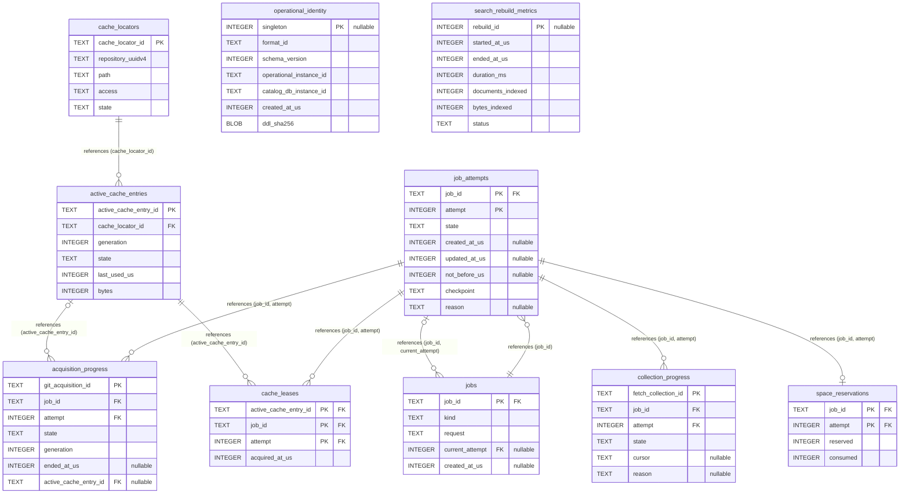

# Operational Store Schema (operational.sqlite3)

Execution management, worker progress, and packfile cache leases under **Operational Schema Version 1**.

- **Physical Database:** `operational.sqlite3`
- **DDL SHA-256:** `dafdc014ebf3e54e1695ffb0bb3fd953f1a1c893d5b0b13d812740ee2f288def`
- **Product Tables:** 10
- **Physical Foreign Keys:** 9
- **Triggers:** 20
- **Physical Invariant:** Completely physically separate from `catalog.sqlite3`. Loss of Operational DB never compromises Core facts (ADR 0002 §2 PF-P06, PF-P12).

## Physical ER Diagram

## Logical Cross-Store References to Core

Operational tables maintain application-level references to Core identities without SQLite foreign key constraints:

| Operational Table | Operational Column | Core Target Table | Core Column | Invariant & ADR Reference |
|---|---|---|---|---|
| `operational_identity` | `catalog_db_instance_id` | `database_identity` | `db_instance_id` | Strict 1:1 ownership binding between Operational DB and Core Catalog (ADR 0002 §2 PF-P11). |
| `acquisition_progress` | `git_acquisition_id` | `git_acquisitions` | `git_acquisition_id` | Git acquisition worker progress tracking Core acquisition entity (ADR 0002 §3.2, PF-P04). |
| `collection_progress` | `fetch_collection_id` | `fetch_collections` | `fetch_collection_id` | API collection worker progress tracking Core fetch collection (ADR 0002 §3.2, PF-P03). |
| `cache_locators` | `repository_uuidv4` | `repositories` | `repository_uuidv4` | Physical cache directory mapping. Core incomplete preservation obligations block cache GC even if locator disappears (three-store-invariants §1). |

[Back to Architecture Overview](overview.md)
