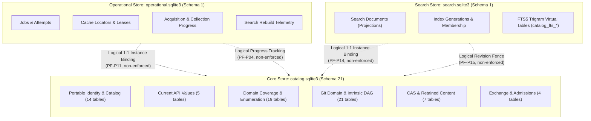

# Three-Store Boundary Architecture Overview

Authoritative physical separation under **ADR 0002** and binding owner decisions **PF-P01–PF-P17**.

## Physical Stores and Boundaries

The database architecture intentionally partitions concerns into three distinct SQLite databases:

| Store | Physical Database | Schema Version | Product Tables | Responsibility & Invariant |
|---|---|---|---|---|
| **Core** | `catalog.sqlite3` | 21 | 70 | Authoritative domain facts, entities, immutable observations, coverage claims, code listings, Git DAG, and Exchange staging. |
| **Operational** | `operational.sqlite3` | 1 | 10 | Disposable execution tracking, jobs, attempts, packfile cache leases, reservations, and progress. Loss never compromises Core facts. |
| **Search** | `search.sqlite3` | 1 | 4 | Rebuildable FTS5 trigram virtual tables, search document projections, and index generations. Excluded from normal backups. |

## Physical vs Logical Relationships

- **Physical Foreign Keys (Solid Edges):** Enforced by SQLite foreign key constraints (`PRAGMA foreign_keys=ON`). **Never cross store boundaries.**
- **Logical References (Dashed Edges):** Application-level identities and revision fences that connect secondary stores to Core. Loss or absence of secondary stores leaves Core evidence 100% intact and valid.

## Cross-Store Logical Dependency Reference

| Source Store & Table | Source Column(s) | Target Store & Table | Target Column(s) | Reference | Description |
|---|---|---|---|---|---|
| `operational.operational_identity` | `catalog_db_instance_id` | `core.database_identity` | `db_instance_id` | ADR 0002 §2 PF-P11, §3.2 | Strict 1:1 ownership binding between Operational database and Core Catalog instance. Operational DB is disposable without affecting Core domain facts. |
| `operational.acquisition_progress` | `git_acquisition_id` | `core.git_acquisitions` | `git_acquisition_id` | ADR 0002 §3.2, PF-P04 | Operational Git acquisition worker progress tracking associated Core Git acquisition entity. Interrupted/uncommitted progress is safely discarded. |
| `operational.collection_progress` | `fetch_collection_id` | `core.fetch_collections` | `fetch_collection_id` | ADR 0002 §3.2, PF-P03, PF-P04 | Operational API collection worker progress tracking associated Core fetch collection. Missing progress triggers fallback to fresh full acquisition. |
| `operational.cache_locators` | `repository_uuidv4` | `core.repositories` | `repository_uuidv4` | ADR 0002 §3.2, three-store-invariants §1 | Transient physical Git packfile cache locator mapped to Core repository UUID. Incomplete Core preservation obligations block cache GC even if locator disappears. |
| `search.search_identity` | `catalog_db_instance_id` | `core.database_identity` | `db_instance_id` | ADR 0002 §2 PF-P14, §3.3 | Strict 1:1 ownership binding between Search database and Core Catalog instance. Search DB is excluded from backup and rebuildable at any time. |
| `search.search_identity` | `core_revision_fence` | `core.database_identity` | `local_revision` | ADR 0002 §3.3, §4, PF-P15 | Search database freshness fence tracking Core local_revision counter. Stale fence triggers direct-scan fallback or rebuild notification. |
| `search.index_generations` | `core_revision_fence` | `core.database_identity` | `local_revision` | ADR 0002 §3.3, §4, three-store-invariants §4 | Per-generation index snapshot fence recording Core local_revision at projection time for snapshot pinning. |
| `search.search_documents` | `source_key` | `core.git_objects` | `git_object_id` | ADR 0002 §3.3, §4 | Code and commit search projections (kind IN ('code', 'commits')). The source_key is encoded as 'git:<git_object_id>' derived from Core git_objects.git_object_id via valid git facts. Disposable derivative; application-level polymorphic mapping, not an enforced foreign key. |
| `search.search_documents` | `source_key` | `core.text_bodies` | `sha256` | ADR 0002 §3.3, §4 | PR and Issue search projections (kind IN ('pr', 'issue')). The source_key is derived from lower hex-encoded text_bodies.sha256 for domain text bodies, or SHA-256 hex digest of standalone issue titles. Disposable derivative; application-level polymorphic mapping, not an enforced foreign key. |

## Navigation

- [Core Schema Overview](core-overview.md) — 70 tables partitioned into 7 functional modules.
- [Operational Schema ER Diagram](operational.md) — 10 execution and cache management tables.
- [Search Schema ER Diagram](search.md) — 4 derivative search tables and runtime FTS5 trigram virtual tables.
