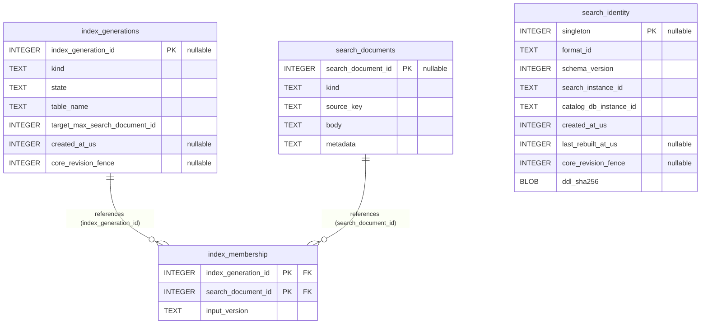

# Search Store Schema (search.sqlite3)

Rebuildable FTS5 search projections and index generations under **Search Schema Version 1**.

- **Physical Database:** `search.sqlite3`
- **DDL SHA-256:** `1fff79854824aae850184fd4af16a29ee8574769e42a139283b01825520a84b7`
- **Fixed Product Tables:** 4
- **Physical Foreign Keys:** 2
- **Triggers:** 8
- **Physical Invariant:** Completely rebuildable from Core store. Excluded from normal backups (ADR 0002 §2 PF-P14, PF-P16, PF-P17).

## Fixed Packaged Schema ER Diagram



## Dynamic FTS5 Virtual Tables (`catalog_fts_<generation_id>`)

At runtime, an explicit `repo-catalog index rebuild` command populates `search_documents` and instantiates dedicated SQLite FTS5 virtual tables:

```sql
CREATE VIRTUAL TABLE catalog_fts_<generation_id> USING fts5(
    body,
    tokenize='trigram case_sensitive 1',
    content='',
    detail=full
);
```

- **Generation Lifecycle:** Indexed generations transition through states: `building` -> `ready` -> `retired` -> `removed` in table `index_generations`.
- **FTS5 Internal Shadow Tables:** SQLite automatically creates internal shadow tables for each virtual table (`catalog_fts_<id>_data`, `catalog_fts_<id>_idx`, `catalog_fts_<id>_content`, `catalog_fts_<id>_docsize`, `catalog_fts_<id>_config`). These shadow tables are derivative implementation artifacts and are intentionally excluded from product schema inventories.
- **Search Fallback:** If `search.sqlite3` is absent, stale, or corrupt, search commands automatically fall back to direct-scan queries against `catalog.sqlite3` without failing (ADR 0002 §2 PF-P15).

## Logical Cross-Store References to Core

| Search Table | Search Column | Core Target Table | Core Column | Invariant & ADR Reference |
|---|---|---|---|---|
| `search_identity` | `catalog_db_instance_id` | `database_identity` | `db_instance_id` | Strict 1:1 ownership binding between Search DB and Core Catalog (ADR 0002 §2 PF-P14). |
| `search_identity` | `core_revision_fence` | `database_identity` | `local_revision` | Global index freshness fence tracking Core local revision (ADR 0002 §3.3, §4). |
| `index_generations` | `core_revision_fence` | `database_identity` | `local_revision` | Per-generation snapshot fence recorded during rebuild projection (three-store-invariants §4). |
| `search_documents` | `source_key` | `git_objects` / resources | `oid_hex` / doc keys | Projections derived from Core Git blobs (code), PR documents (pr), and Issue resources (issue). |

[Back to Architecture Overview](overview.md)
