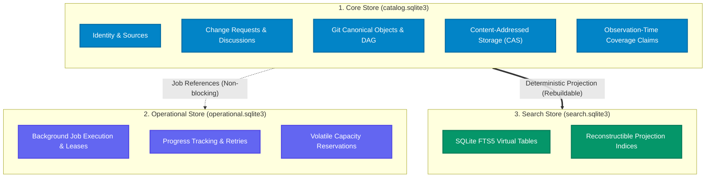

# git-repo-db 開発者ドキュメント

  

    <strong>git-repo-db</strong> は、Git リポジトリおよび GitHub の Pull Request / Issue / Code データをローカルの SQLite データベースへ構造化・永続化し、オフライン環境で高速に横断検索・関係解析を可能にするデータベースエンジンおよび CLI ツールです。
  

  

    本サイトの図は、選択した製品 revision の IR を可視化します。このページに示す Core / Operational / Search の計 84 テーブルは Schema 21 の実装基盤についての表記です。採択済み設計には５つの責務境界があり、この図の３スキーマは通常の初期化で作成されるファイル数や全構成の上限を意味しません。詳細は<a href="architecture/">アーキテクチャ概要</a>を参照してください。
  

## このサイトの読み方

以下は 2026-10-27 時点の製品コミット [`5d28bb33`](https://github.com/TakashiSasaki/git-repo-db/tree/5d28bb33bf62d7b0eff7e6547a4fda84c1815a9d) に基づく案内です。サイトのビルド時に選択した製品・文書の revision はページ末尾に別々に表示されます。文書は製品に同期して更新されるとは限らず、選択製品の IR が検証されても手書き説明すべての正しさを保証しません。

| 区分 | この時点の範囲 | 読み始める場所 |
|---|---|---|
| 通常ランタイム | `repo-catalog init` は Core を初期化。Operational は必要時、Search は明示的に作成。３スキーマは必須３ファイルを意味しない | [実行経路](architecture/) |
| 実装済み opt-in | P1 の４ファクトリーと独立 Access CLI は通常 `init` とは別 | [選択機能と根拠](architecture/) |
| 採択済み目標 | Core / Context / Access / Operational / Search の５責務。採択は全機能の既定起動を意味しない | [ADR 0029 正本](https://github.com/TakashiSasaki/git-repo-db/blob/5d28bb33bf62d7b0eff7e6547a4fda84c1815a9d/docs/adr/0029-independent-access-store.md) |
| 履歴・証跡 | 古い CLI、データモデル、監査や検証結果は対象 revision に限定 | [現行参照と履歴への案内](https://github.com/TakashiSasaki/git-repo-db/blob/5d28bb33bf62d7b0eff7e6547a4fda84c1815a9d/docs/current-runtime-reference.md) |

## データベーススキーマ可視化ワークベンチ

リポジトリの真実（authoritative SQLite DDL）から直接生成された、4つの異なる切り口によるスキーマ可視化ツール群です。目的や用途に合わせて直接アクセスできます。

-   🔍 **[インタラクティブ・スキーマビューアー](schema/viewer/)**
    
    ---
    
    ブラウザ単体で動作するスタンドアロン HTML 探索ワークベンチ。
    
    - **3 ストア切り替え**: Core (70) / Operational (10) / Search (4)
    - **高速絞り込み**: テーブル名・カラム名リアルタイム検索、機能グループフィルタ
    - **リレーション探査**: 物理 FK のインタラクティブ移動、論理依存の識別
    - **動的グラフ**: 選択テーブルの SVG 近傍依存性グラフ描画
    
    [👉 ビューアーを起動する (`/schema/viewer/`)](schema/viewer/){ .md-button .md-button--primary }

-   📊 **[Mermaid ER ダイアグラム集](schema/mermaid/)**
    
    ---
    
    ビルド時に事前レンダリングされた高解像度 SVG ベクター ER ダイアグラム。
    
    - **全体俯瞰**: 3 ストアの物理境界とデータフロー
    - **Core モジュール別**: Identity, Current State, Coverage, Git DAG, CAS, Exchange
    - **サブシステム**: Operational ジョブ管理、Search FTS5 仮想テーブル
    
    [👉 ダイアグラム一覧を見る (`/schema/mermaid/`)](schema/mermaid/){ .md-button }

-   📥 **[DBML エクスポートとダウンロード](schema/dbml/)**
    
    ---
    
    Database Markup Language (DBML) 形式のスキーマ定義ファイル。
    
    - **ダウンロード**: `core.dbml`, `operational.dbml`, `search.dbml`, `combined.dbml`
    - **外部ツール連携**: dbdocs.io や dbdiagram.io にインポートして利用可能
    
    [👉 DBML ガイドとダウンロード (`/schema/dbml/`)](schema/dbml/){ .md-button }

-   📑 **[スキーマ完全目録とテーブル一覧](schema/)**
    
    ---
    
    全 84 プロダクトテーブルの分類と構造解説。
    
    - **ストア別構成**: Core Schema 21 / Operational Schema 1 / Search Schema 1
    - **キー制約**: 主キー (PK)・外部キー (FK)・一意制約 (UK)・生成カラムの一覧
    
    [👉 スキーマ概要を開く (`/schema/`)](schema/){ .md-button }

---

### 可視化ダイアグラムへのクイックアクセス

特定の機能領域やサブシステムの ER ダイアグラムに直接ジャンプできます：

| 対象ストア / 領域 | ダイアグラム名称 | 主な収録内容 | リンク |
|---|---|---|---|
| **全体統合** | **Three-Store 全体俯瞰** | Core / Operational / Search の境界と参照方向 | [表示](schema/mermaid/overview/) |
| **Core Store** | **全体構造マップ** | 全 70 テーブルの機能グループ配置と主要依存関係 | [表示](schema/mermaid/core-overview/) |
| **Core Store** | **ポータブル識別子 (Identity)** | Source, Service, Repository, User 識別子マッピング | [表示](schema/mermaid/core-identity/) |
| **Core Store** | **現行状態プロジェクション** | Pull Request, Issue, Review, Comment 最新状態 | [表示](schema/mermaid/core-current-state/) |
| **Core Store** | **カバレッジ・取得証跡** | 観測時刻に基づく 5 列のカバレッジ保証と取得事実 | [表示](schema/mermaid/core-coverage/) |
| **Core Store** | **Git ドメイン・コミット DAG** | Commit, Tree, Blob, Tag, Ref の物理構造 | [表示](schema/mermaid/core-git/) |
| **Core Store** | **CAS・完全性・保持義務** | Content-Addressed Storage, 整合性検証, 既存スキーマの隔離領域 | [表示](schema/mermaid/core-cas/) |
| **Core Store** | **Exchange ステージング** | リモートカタログ間連携, インポート一時領域 | [表示](schema/mermaid/core-exchange/) |
| **Operational Store** | **実行ジョブ・進捗** | 非同期ジョブ実行, 試行回数, キャッシュリース | [表示](schema/mermaid/operational/) |
| **Search Store** | **検索プロジェクション・FTS5** | 全文検索仮想テーブル, 再構築可能な転置索引 | [表示](schema/mermaid/search/) |

---

## Three-Store Boundary アーキテクチャ

以下は **[ADR 0002](adr/0002-three-store-boundary-architecture/)** に由来する実装済み Schema 21 基盤の３スキーマの図です。採択済み目標設計と通常の起動経路は[アーキテクチャ概要](architecture/)を参照してください。

| ストア | 物理ファイル名 | スキーマ | テーブル数 | 主な責務と性質 |
|---|---|---|---|---|
| **Core Store** | `catalog.sqlite3` | Schema 21 | 70 | 永続的なドメイン事実、Identity、Change Request、Git DAG、CAS バイト列、Exchange 連携。バックアップ対象。 |
| **Operational Store** | `operational.sqlite3` | Schema 1 | 10 | ジョブ実行管理、試行回数、キャッシュリース、容量予約。揮発性・自動初期化可能。 |
| **Search Store** | `search.sqlite3` | Schema 1 | 4 | FTS5 仮想テーブル、再構築可能な検索プロジェクション。明示的 rebuild のみ、破損時は Core スキャンへフォールバック。 |

👉 詳しい物理境界と分離原則は [**Three-Store Boundary アーキテクチャ解説**](architecture/three-store-boundary/) をご覧ください。

---

## 設計決定 (ADR) と開発ガイド

- 📜 [**Architecture Decision Records (ADRs)**](adr/)
  - [**ADR 0001: 開発・リリース検証ライフサイクル**](adr/0001-validation-lifecycle-architecture/)  
    軽量な開発モード（Development Validation）と厳格なリリース受入（Release Acceptance）の分離。
  - [**ADR 0002: Three-Store Boundary アーキテクチャ**](adr/0002-three-store-boundary-architecture/)  
    Core / Operational / Search の 3 ストア物理分離方針と結合決定 PF-P01〜PF-P17。
- 🛠️ [**開発・テスト・検証ガイド**](development/)  
  Python 3.12 / uv による環境構築、単体テスト、スキーマ可視化の検証コマンド、ドキュメントサイトのビルド方法。
- 📱 **PWA & オフライン対応**  
  マニフェストとサービスワーカーを提供しています。インストール可否はブラウザーと環境に依存し、すべてのページがオフラインで利用できる保証はありません。
- 🐙 [**GitHub リポジトリ (TakashiSasaki/git-repo-db)**](https://github.com/TakashiSasaki/git-repo-db)  
  ソースコード、Issue、Pull Request の最新状態。
